# AETHENTRA ML Task 01 — Final Report
## Antarctic Weekly Sea-Ice Concentration & Extent Forecasting

Status legend: **COMPLETED** = implemented, executed and verified; **IMPLEMENTED** = code exists and tested but not executed on real data; **NOT DONE** = documented gap.

## 1. Scientific objective

Forecast the 7-day-mean Antarctic sea-ice concentration for days t+1…t+7 on the native 25 km grid, and derive sea-ice extent and area (15 % threshold). Definitions: SCIENTIFIC_PROBLEM_DEFINITION.md.

## 2. Datasets actually acquired and verified coverage

* **NOAA/NSIDC SIC CDR v6 (G02202)** — 48 files, 48 MD5-verified; daily 1979-01-01 … 2026-11-01 (17,470 days in files, 2 absent); 67 days are entirely fill.
* **NCEP/NCAR R1 daily** air/uwnd/vwnd/slp south of 35°S — coverage air: 1979-01-01…2026-03-17, uwnd: 1979-01-01…2026-03-17, vwnd: 1979-01-01…2026-03-17, slp: 1979-01-01…2026-03-17.
* Comparison: NSIDC Sea Ice Index v4 daily extent (Stage 1).
* **Not acquired:** ERA5 (CDS token), Copernicus Marine products (account), NSIDC-0803 (Earthdata login).

## 3. Preprocessing performed

Native-grid daily cube (no regridding of labels), static ocean mask from the CDR surface-type mask, exact cell areas, explicit gaps, per-day QA statistics, independent extent cross-check, NCEP bilinear interpolation to cell centres. Details: DATA_QUALITY_REPORT.md.

## 4. Features used

40 features (SIC history, train-only climatology/anomalies, spatial context, hemispheric state, season, past-week atmosphere). FEATURE_ENGINEERING.md.

## 5. Splits

| Split | Issue dates | Climatology fit |
|---|---|---|
| Train | 1979-01-01 … 2015-12-31 | 1979–2015 |
| Validation | 2016-01-01 … 2020-12-31 | 1979–2015 |
| Test (once) | 2021-01-01 … 2025-12-31 | 1979–2020 (final refit) |

## 6. Models actually trained

| Model | Status | Checkpoint |
|---|---|---|
| LightGBM residual | COMPLETED (trained, checkpoint verified, validated) | `models/checkpoints/lgbm_residual.lgb.txt` |
| LightGBM absolute | COMPLETED (trained, checkpoint verified, validated) | `models/checkpoints/lgbm_absolute.lgb.txt` |
| LightGBM residual, SIC-only | COMPLETED (trained, checkpoint verified, validated) | `models/checkpoints/lgbm_residual_sic_only.lgb.txt` |
| XGBoost residual | COMPLETED (trained, checkpoint verified, validated) | `models/checkpoints/xgb_residual.xgb.json` |
| Random forest residual | COMPLETED (trained, checkpoint verified, validated) | `models/checkpoints/rf_residual.joblib` |
| LightGBM residual (Optuna-tuned) | COMPLETED | `models/checkpoints/lgbm_residual_tuned.lgb.txt` |
| **Final model** (LightGBM residual (Optuna-tuned), refit 1979–2020) | COMPLETED | `models/final/final_model.lgb.txt` |
| U-Net (spatial deep learning, addendum) | U-Net IMPLEMENTED, not trained (PyTorch is not installed) | — |

### U-Net addendum

* U-Net candidate: **IMPLEMENTED, not trained** — PyTorch is not installed. The download host of the CUDA wheel could not be reached from the sandboxed build session. Install with `python -m pip install torch==2.5.1 --index-url https://download.pytorch.org/whl/cu124`, then run `bash scripts/run_ml01_cnn.sh` (stacks → train → validate → frozen decision → refit → single test).
* ConvLSTM: not implemented — the weekly-mean target with 7- to 56-day input summaries is already encoded as channels; a recurrent model would only be justified if the U-Net shows that spatial context helps.

Optuna: 5 trials; best validation-sample MAE 2.795 pp vs 2.805 pp untuned. Hyper-parameters: MODEL_TRAINING_REPORT.md.

## 7. Baseline and candidate results (validation 2016–2020, seasonal ice zone)

| Method | seasonal_ice_zone | ice_edge_band |
|---|---|---|
| Persistence (latest day) | 3.81 | 11.89 |
| Persistence (7-day mean) | 4.83 | 14.68 |
| Climatology (train) | 9.57 | 22.98 |
| Linear 7-day trend | 4.68 | 13.65 |
| Anomaly persistence | 4.61 | 12.95 |
| LightGBM absolute | 3.09 | 10.23 |
| LightGBM residual | 3.07 | 10.16 |
| LightGBM residual, SIC-only | 3.10 | 10.24 |
| Random forest residual | 3.30 | 10.33 |
| XGBoost residual | 3.07 | 10.19 |
| LightGBM residual (Optuna-tuned) | 3.06 | 10.13 |

(MAE in pp; full metric tables in MODEL_EVALUATION_REPORT.md.)

**Selection:** LightGBM residual (Optuna-tuned) — rank-sum over validation SIZ MAE, SIZ RMSE, IIEE, extent MAE; ties -> simpler model; beats the best baseline (Persistence (latest day)) on all criteria: True. Recorded 2026-11-07T22:46:50+00:00 before the test evaluation.

## 8. Final test metrics (2021–2025, evaluated once)

### Seasonal ice zone

| Method | MAE (pp) | RMSE (pp) | Bias (pp) | R² | AW-MAE | AW-RMSE | Extent MAE (10³ km²) | Extent bias (10³ km²) | Rel. extent err. | Area MAE (10³ km²) | IIEE (10³ km²) | IoU | F1 | Precision | Recall |
|---|---|---|---|---|---|---|---|---|---|---|---|---|---|---|---|
| FINAL model | 3.02 | 7.14 | 0.41 | 0.974 | 3.03 | 7.14 | 132 | 59 | 1.66 % | 123 | 557 | 0.951 | 0.975 | 0.972 | 0.977 |
| Persistence (latest day) | 3.70 | 8.72 | -0.00 | 0.962 | 3.72 | 8.73 | 391 | -49 | 5.10 % | 318 | 665 | 0.941 | 0.970 | 0.972 | 0.967 |
| Persistence (7-day mean) | 4.64 | 10.82 | -0.02 | 0.941 | 4.66 | 10.83 | 602 | -3 | 7.99 % | 548 | 903 | 0.921 | 0.959 | 0.959 | 0.959 |
| Climatology (train) | 10.75 | 19.58 | 3.99 | 0.806 | 10.77 | 19.57 | 2,294 | 2,294 | 30.38 % | 809 | 2,651 | 0.803 | 0.891 | 0.814 | 0.984 |
| Linear 7-day trend | 4.52 | 10.43 | 0.17 | 0.945 | 4.54 | 10.43 | 346 | -229 | 4.21 % | 161 | 679 | 0.939 | 0.969 | 0.979 | 0.959 |
| Anomaly persistence | 4.53 | 9.57 | 0.39 | 0.954 | 4.54 | 9.57 | 304 | 124 | 4.04 % | 230 | 821 | 0.928 | 0.963 | 0.957 | 0.968 |

### All ocean cells

| Method | MAE (pp) | RMSE (pp) | Bias (pp) | R² | AW-MAE | AW-RMSE | Extent MAE (10³ km²) | Extent bias (10³ km²) | Rel. extent err. | Area MAE (10³ km²) | IIEE (10³ km²) | IoU | F1 | Precision | Recall |
|---|---|---|---|---|---|---|---|---|---|---|---|---|---|---|---|
| FINAL model | 1.29 | 4.67 | 0.16 | 0.983 | 1.37 | 4.82 | 127 | 50 | 1.63 % | 119 | 585 | 0.949 | 0.974 | 0.971 | 0.976 |
| Persistence (latest day) | 1.57 | 5.70 | -0.00 | 0.975 | 1.68 | 5.88 | 395 | -45 | 5.12 % | 321 | 696 | 0.939 | 0.968 | 0.970 | 0.966 |
| Persistence (7-day mean) | 1.97 | 7.05 | -0.01 | 0.961 | 2.10 | 7.27 | 607 | -3 | 8.01 % | 550 | 941 | 0.918 | 0.957 | 0.958 | 0.957 |
| Climatology (train) | 4.59 | 12.73 | 1.68 | 0.874 | 4.88 | 13.12 | 2,235 | 2,235 | 29.93 % | 785 | 2,710 | 0.799 | 0.889 | 0.814 | 0.978 |
| Linear 7-day trend | 1.92 | 6.83 | 0.08 | 0.964 | 2.05 | 7.04 | 347 | -229 | 4.22 % | 167 | 711 | 0.937 | 0.967 | 0.978 | 0.957 |
| Anomaly persistence | 1.93 | 6.25 | 0.17 | 0.970 | 2.06 | 6.44 | 308 | 124 | 4.06 % | 232 | 859 | 0.926 | 0.961 | 0.956 | 0.967 |

Final model vs persistence: SIZ MAE +18.5 %, IIEE +16.1 %, extent MAE +67.7 % (positive = improvement).

80 % interval coverage on test: 0.881 (nominal 0.80).

## 9. Visualizations

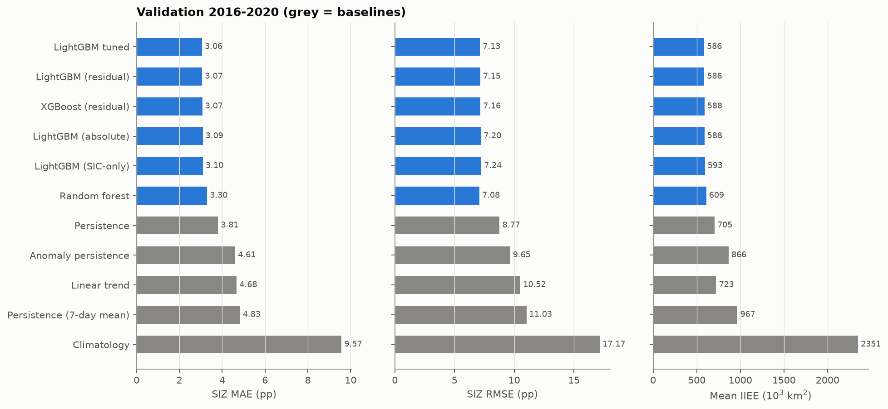
*Validation (2016-2020) full-grid comparison of baselines and ML candidates: MAE and RMSE over the seasonal ice zone (cells whose training climatology reaches 15 %) and mean integrated ice-edge error.*

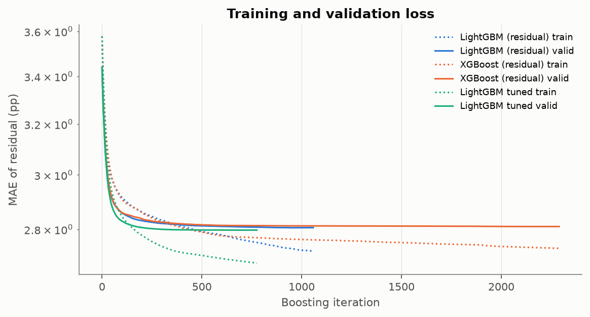
*Training (dotted) and validation (solid) L1 loss of the boosted models on the sampled tables; early stopping at the validation minimum.*

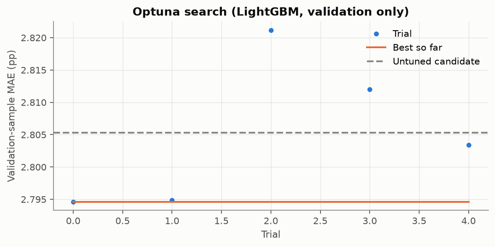
*Optuna TPE trials: validation-sample MAE of each configuration and the running best.*

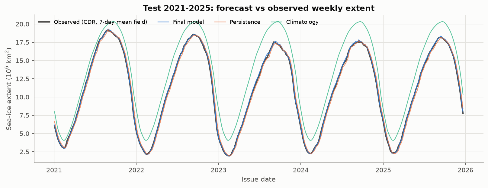
*Weekly sea-ice extent (SIC >= 15 %) of the observed 7-day-mean field and of the forecasts for every test issue date.*

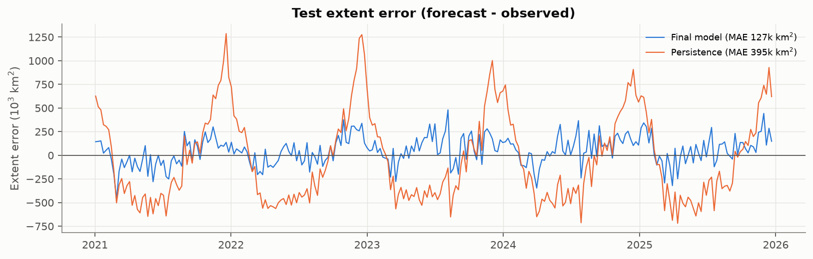
*Extent error per test issue date for the final model and persistence.*

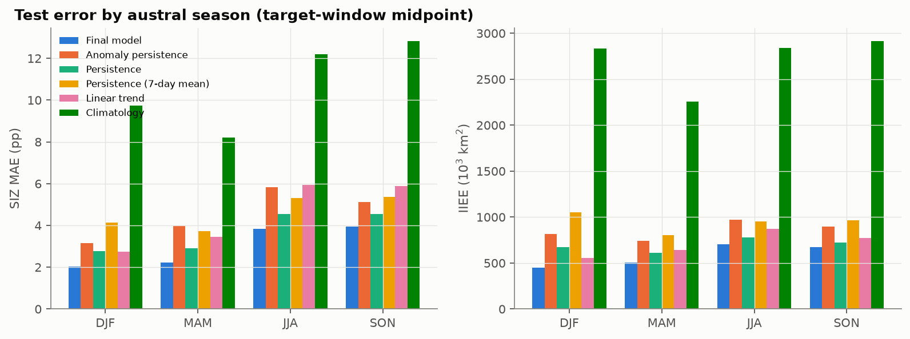
*Test-period MAE (seasonal ice zone) and IIEE by season; DJF = austral summer melt minimum.*

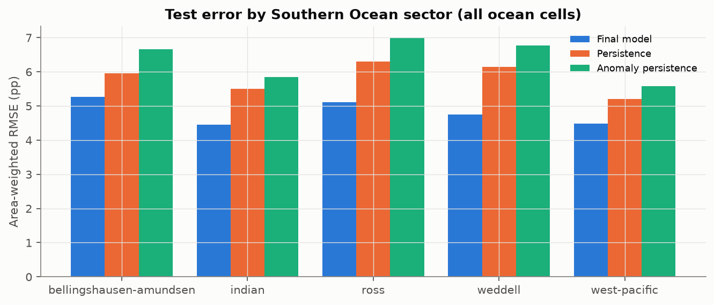
*Area-weighted RMSE per sector (NSIDC sector definitions) over all valid ocean cells.*

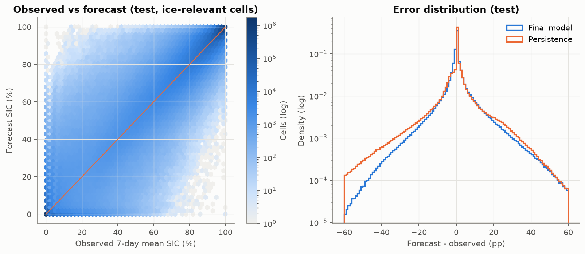
*Left: joint distribution of observed and forecast SIC on cells where any of observation, forecast or persistence is non-zero. Right: error distributions of the final model and persistence.*

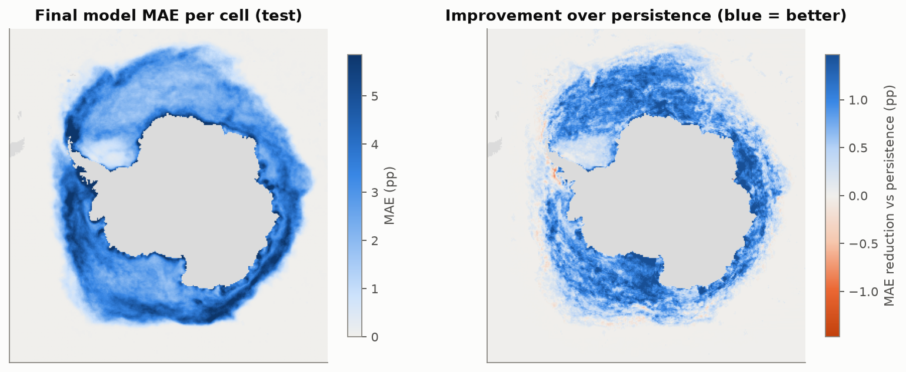
*Per-cell mean absolute error of the final model over all test issue dates and its reduction relative to persistence (native EPSG:3412 grid; grey = land/coast).*

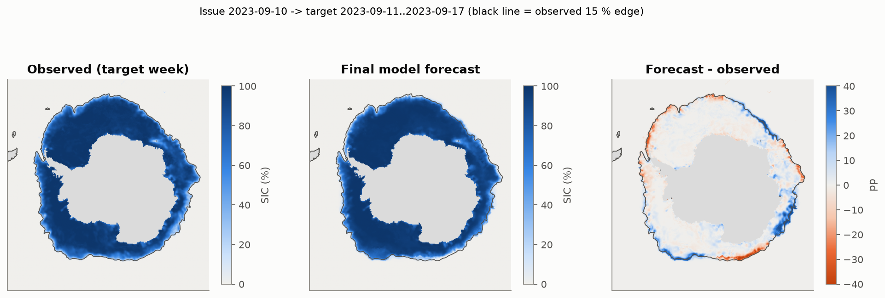
*Example test forecast near the 2023 record-low winter maximum: observed target-week mean SIC, forecast and difference, with the observed 15 % ice edge.*

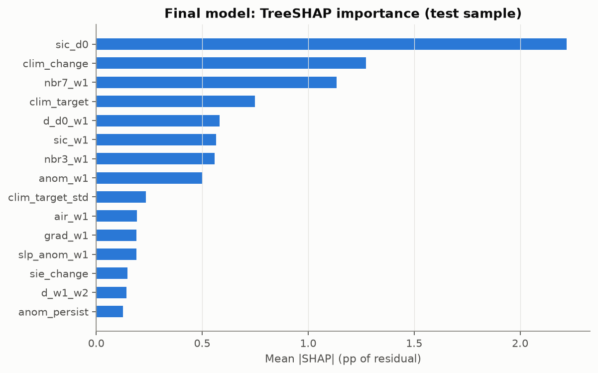
*Mean absolute TreeSHAP contribution of the 15 most influential features of the final model on a random sample of test-period cells.*

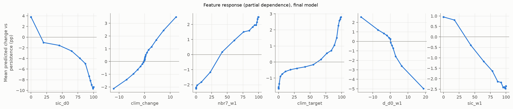
*Partial dependence of the predicted change relative to persistence on the top features.*

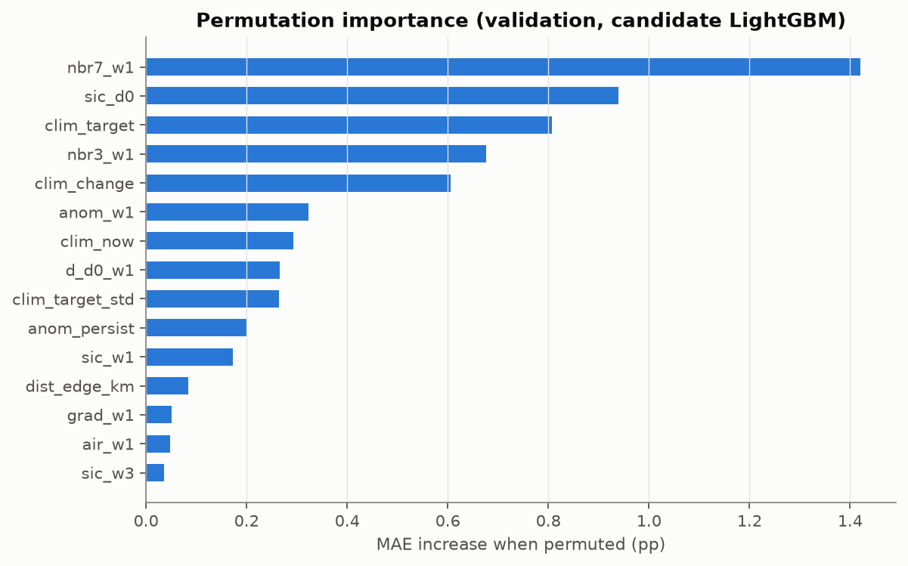
*Increase in MAE when each feature is randomly permuted (validation sample, candidate LightGBM trained on 1979-2015).*

## 10. Latest forecast produced by the inference pipeline

* Forecast `sic7d_20261101_aethentra-sic-weekly-20261108-v1` issued 2026-11-01 for 2026-11-02 … 2026-11-08 (model aethentra-sic-weekly-20261108-v1).
* Extent 15.95 × 10⁶ km², area 13.69 × 10⁶ km² (persistence extent 16.14, climatology 18.52).
* Inputs: latest observation 2026-11-01, persistence coverage 100.0%, atmosphere used: False. Warnings: ['Atmospheric inputs available for 0/7 days; atmospheric features set to missing.', 'Using the SIC-only fallback model (declared before test; its test metrics are reported separately).'].
* Uncertainty validated: False — Empirical coverage differs from nominal by > 5 pp; interval NOT exported.
* Files: `outputs/forecasts/sic7d_20261101_aethentra-sic-weekly-20261108-v1/` (sic7d_20261101_aethentra-sic-weekly-20261108-v1.nc, sic7d_20261101_aethentra-sic-weekly-20261108-v1_ice_edge.geojson, sic7d_20261101_aethentra-sic-weekly-20261108-v1.json) and `layers/` for the frontend.

## 11. Limitations

See MODEL_CARD.md (failure modes) and MISSING_PREREQUISITES.md. Key points: interim 2.5° atmosphere instead of ERA5; passive-microwave biases; no target-week weather; 2021–2025 includes record lows; expert review pending.

* NCEP/NCAR R1 daily 2026 file: 76 days available upstream when last retrieved (2026-11-07T19:32:40+00:00), i.e. through 2026-03-17. NOAA PSL has not extended the series since; later retries were refused (HTTP 429 / 403). This is an upstream data gap, not a pipeline fault: ML-01 forecasts after 2026-03-17 use the SIC-only fallback declared before the test, whose test metrics are reported separately. Remedy: ERA5 atmosphere (same CDS key as ML-02) + retraining, or a resumed R1 feed.

## 12. Reproducibility

REPRODUCIBILITY_GUIDE.md lists every command; all numbers in this report were generated by `scripts/build_docs.py` from artifacts.

Tests: 56 passed, 1 failed, 2 skipped (2026-11-08T09:52:35+00:00).

## 13. Integration status

* Inference pipeline (`src/aethentra/inference/`) — COMPLETED: NetCDF + JSON + GeoJSON outputs.
* FastAPI service (`api/main.py`: /health, /model/info, POST /forecast/weekly, /forecast/latest, /forecast/history, /forecast/metrics, /forecast/metadata, file download by logical name, /layers/…) — COMPLETED and tested (TestClient + live uvicorn on 127.0.0.1); not a production deployment.
* Frontend layers (`outputs/forecasts/<id>/layers/`: EPSG:3412 GeoTIFFs, EPSG:4326 PNG overlays with bounds, GeoJSON edges, extent time series, regional summary, manifest with data_type labels) — COMPLETED.
* Web viewer (`frontend/`, served by FastAPI at `/viewer/`; `/` redirects there): COMPLETED and run locally — sea-ice and 2 m temperature tabs, polar-stereographic previews rendered server-side from the native EPSG:3412 GeoTIFFs (`/layers/{sic|t2m}/…`), GeoTIFF downloads, every layer badged by data_type (forecasts framed and stamped MODEL PREDICTION), forecast summary, test skill and limitations. Start with `bash scripts/serve.sh` (loopback 127.0.0.1:8000). Not a production deployment: no authentication, TLS, process supervision or public hosting — those need an owner decision on where to host.

## 14. Recommended next research direction

See NEXT_STEPS.md.