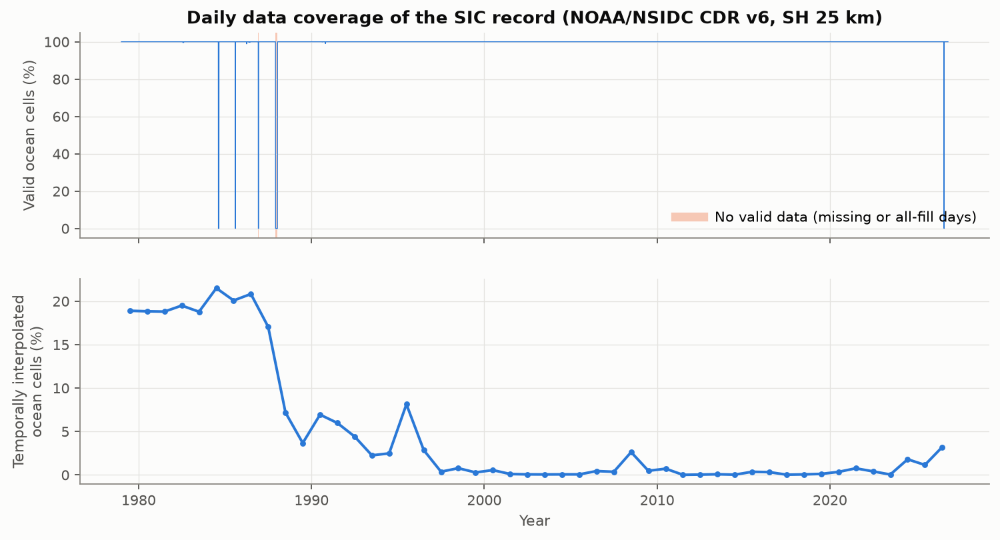
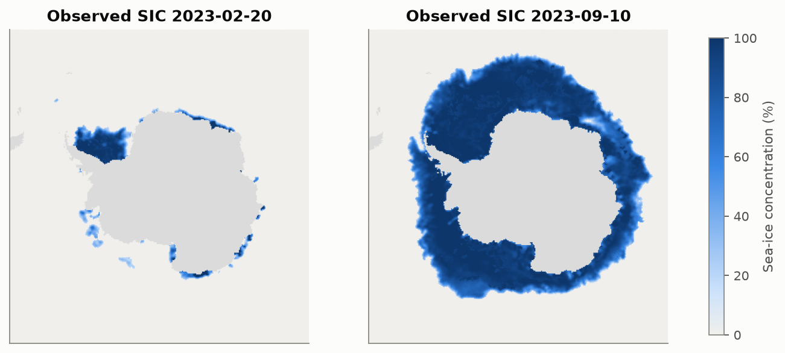
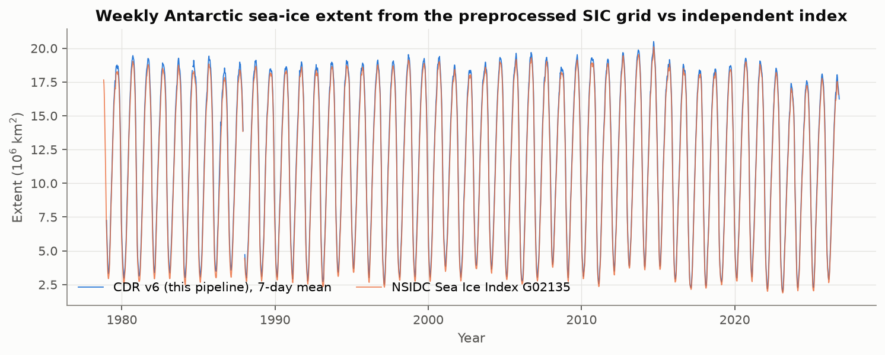

# Data Quality Report — AETHENTRA ML Task 01

Generated from `outputs/reports/data_validation/data_quality.json` (`python scripts/validate_data.py`).

## 1. Primary SIC record (NOAA/NSIDC CDR v6, SH 25 km)

| Check | Result |
|---|---|
| Calendar span | 1979-01-01 … 2026-11-01 (17,472 days) |
| Grid | 332 × 316 cells, EPSG:3412; 83,019 static ocean cells (46.99 × 10⁶ km²) |
| Cell area range | 444.1 – 664.4 km² (exact, projection scale factor) |
| Input files MD5-verified | 48 / 48 |
| Days absent from files | 2 |
| Days present but entirely missing (all ocean cells fill) | 67 |
| Duplicate days | 0 |
| SIC values outside 0–100 (not fill) | 0 |
| Days with > 1 % of ocean cells missing | 69 |
| Ocean cells flagged 'No_input_data' (QA bit 8) | 121,048,571 (SMMR every-other-day era; values temporally interpolated by NSIDC) |
| Non-ocean cells carrying a value | 0 |
| Cells whose surface type varies (< 99 % ocean) | 0 (excluded from the static ocean mask) |
| Day-to-day hemispheric extent jumps > 1.0 × 10⁶ km² | 5 |

### Effective gaps (no valid ocean data)

| Start | End | Days |
|---|---|---|
| 1984-08-12 | 1984-08-24 | 13 |
| 1985-08-05 | 1985-08-09 | 5 |
| 1986-12-04 | 1986-12-10 | 7 |
| 1987-12-03 | 1988-01-13 | 42 |
| 2026-08-09 | 2026-08-10 | 2 |

Years with > 20 % temporally interpolated ocean cells (SMMR alternate-day sampling): 1984, 1985, 1986.

Extent jumps flagged (date, |Δ| in 10⁶ km²): 1985-08-10 (1.40), 1986-06-19 (1.37), 1986-06-24 (1.03), 1986-12-11 (1.81), 1988-01-14 (8.84).
They are retained (not removed); they coincide with sensor transitions / gap edges and are excluded from labels only through the
per-cell ≥5-of-7-day rule when data are missing.

## 2. Independent cross-check of the derived extent

Daily extent computed by this pipeline from the CDR grid vs NSIDC Sea Ice Index v4 (G02135): 15,817 matched days, mean difference +0.356 ± 0.108 × 10⁶ km², r = 0.9998. G02135 uses NASA Team (NSIDC-0051/0081) on the same 25 km grid; CDR v6 combines NASA Team and Bootstrap -> systematic differences expected.

## 3. Atmospheric predictors (NCEP/NCAR R1)

| Variable | First | Last | Days | Missing days in span | Min | Max | NaN |
|---|---|---|---|---|---|---|---|
| air | 1979-01-01 | 2026-03-17 | 17,243 | 0 | 185.2 | 313.4 | 0 |
| uwnd | 1979-01-01 | 2026-03-17 | 17,243 | 0 | -31.8 | 31.9 | 0 |
| vwnd | 1979-01-01 | 2026-03-17 | 17,243 | 0 | -27.8 | 31.1 | 0 |
| slp | 1979-01-01 | 2026-03-17 | 17,243 | 0 | 92728.0 | 112318.0 | 0 |

SIC grid latitude range -89.84…-39.36 lies inside the atmosphere subset (-90.0…-35.0): True.

## 4. Handling rules (no silent discarding)

* Missing / fill values are stored as 255 and become NaN — never 0 %. Land, coast and lake cells are excluded by the static ocean mask.
* Targets need ≥ 5 of 7 valid days per cell; cells failing this are counted and excluded from that issue date only.
* Issue dates where < 50 % of ocean cells have a persistence value (≤ 3 days old) are skipped and listed in the evaluation summaries.
* No temporal interpolation or gap filling is added by AETHENTRA; NSIDC's own interpolation is flagged in the QA statistics above.

## 5. Figures

