# Model Evaluation Report — AETHENTRA ML Task 01

All numbers come from full-grid evaluations (`experiments/metrics/*/summary.json`). SIC errors are percentage points (pp) of the 7-day-mean concentration; extent/area in km²; IIEE = integrated ice-edge error (area of 15 %-class disagreement); IoU/F1/precision/recall treat 'SIC ≥ 15 %' as the positive class, area-weighted. **Land and missing cells are never counted as 0 %.** R² over all ocean cells is inflated by the many easy open-water cells; use the seasonal-ice-zone (SIZ) and ice-edge-band rows for skill.

## 1. Validation 2016–2020 (model selection)

Issue dates: 260 (2016-01-03 … 2020-12-20); skipped: 0 [].

### Seasonal ice zone

| Method | MAE (pp) | RMSE (pp) | Bias (pp) | R² | AW-MAE | AW-RMSE | Extent MAE (10³ km²) | Extent bias (10³ km²) | Rel. extent err. | Area MAE (10³ km²) | IIEE (10³ km²) | IoU | F1 | Precision | Recall |
|---|---|---|---|---|---|---|---|---|---|---|---|---|---|---|---|
| Persistence (latest day) | 3.81 | 8.77 | -0.01 | 0.961 | 3.82 | 8.77 | 389 | -50 | 4.67 % | 320 | 672 | 0.943 | 0.970 | 0.973 | 0.968 |
| Persistence (7-day mean) | 4.83 | 11.03 | -0.01 | 0.938 | 4.85 | 11.03 | 612 | -5 | 7.62 % | 555 | 928 | 0.922 | 0.959 | 0.959 | 0.959 |
| Climatology (train) | 9.57 | 17.17 | 2.73 | 0.850 | 9.60 | 17.20 | 1,991 | 1,991 | 27.09 % | 529 | 2,293 | 0.830 | 0.907 | 0.840 | 0.987 |
| Linear 7-day trend | 4.68 | 10.52 | 0.15 | 0.944 | 4.69 | 10.52 | 342 | -239 | 3.79 % | 148 | 688 | 0.941 | 0.969 | 0.980 | 0.959 |
| Anomaly persistence | 4.61 | 9.65 | 0.38 | 0.953 | 4.62 | 9.65 | 294 | 127 | 3.77 % | 225 | 827 | 0.930 | 0.964 | 0.959 | 0.969 |
| LightGBM absolute | 3.09 | 7.20 | 0.39 | 0.974 | 3.10 | 7.20 | 107 | 30 | 1.27 % | 106 | 557 | 0.952 | 0.976 | 0.974 | 0.977 |
| LightGBM residual | 3.07 | 7.15 | 0.38 | 0.974 | 3.08 | 7.14 | 117 | 38 | 1.41 % | 104 | 556 | 0.952 | 0.976 | 0.974 | 0.977 |
| LightGBM residual, SIC-only | 3.10 | 7.24 | 0.32 | 0.973 | 3.11 | 7.23 | 122 | 23 | 1.46 % | 104 | 563 | 0.952 | 0.975 | 0.974 | 0.976 |
| Random forest residual | 3.30 | 7.08 | 0.27 | 0.974 | 3.31 | 7.08 | 173 | 158 | 1.93 % | 82 | 578 | 0.951 | 0.975 | 0.968 | 0.982 |
| XGBoost residual | 3.07 | 7.16 | 0.39 | 0.974 | 3.08 | 7.16 | 119 | 41 | 1.42 % | 107 | 558 | 0.952 | 0.976 | 0.974 | 0.977 |
| LightGBM residual (Optuna-tuned) | 3.06 | 7.13 | 0.37 | 0.974 | 3.07 | 7.13 | 116 | 38 | 1.39 % | 104 | 555 | 0.952 | 0.976 | 0.974 | 0.977 |

### All ocean cells

| Method | MAE (pp) | RMSE (pp) | Bias (pp) | R² | AW-MAE | AW-RMSE | Extent MAE (10³ km²) | Extent bias (10³ km²) | Rel. extent err. | Area MAE (10³ km²) | IIEE (10³ km²) | IoU | F1 | Precision | Recall |
|---|---|---|---|---|---|---|---|---|---|---|---|---|---|---|---|
| Persistence (latest day) | 1.62 | 5.74 | -0.01 | 0.975 | 1.73 | 5.91 | 393 | -46 | 4.70 % | 323 | 705 | 0.940 | 0.969 | 0.971 | 0.967 |
| Persistence (7-day mean) | 2.06 | 7.19 | -0.01 | 0.961 | 2.19 | 7.41 | 624 | -5 | 7.69 % | 560 | 967 | 0.919 | 0.958 | 0.958 | 0.958 |
| Climatology (train) | 4.11 | 11.18 | 1.17 | 0.905 | 4.37 | 11.54 | 1,933 | 1,933 | 26.74 % | 520 | 2,351 | 0.827 | 0.905 | 0.840 | 0.982 |
| Linear 7-day trend | 2.00 | 6.91 | 0.08 | 0.964 | 2.13 | 7.11 | 345 | -239 | 3.80 % | 153 | 723 | 0.938 | 0.968 | 0.978 | 0.958 |
| Anomaly persistence | 1.97 | 6.31 | 0.17 | 0.970 | 2.10 | 6.50 | 305 | 127 | 3.83 % | 229 | 866 | 0.927 | 0.962 | 0.957 | 0.968 |
| LightGBM absolute | 1.32 | 4.72 | 0.15 | 0.983 | 1.41 | 4.86 | 107 | 25 | 1.27 % | 104 | 588 | 0.950 | 0.974 | 0.973 | 0.975 |
| LightGBM residual | 1.31 | 4.68 | 0.15 | 0.983 | 1.40 | 4.82 | 118 | 31 | 1.41 % | 101 | 586 | 0.950 | 0.974 | 0.973 | 0.976 |
| LightGBM residual, SIC-only | 1.32 | 4.74 | 0.12 | 0.983 | 1.41 | 4.88 | 122 | 15 | 1.46 % | 102 | 593 | 0.949 | 0.974 | 0.973 | 0.975 |
| Random forest residual | 1.41 | 4.64 | 0.11 | 0.984 | 1.50 | 4.78 | 171 | 155 | 1.92 % | 82 | 609 | 0.948 | 0.974 | 0.967 | 0.980 |
| XGBoost residual | 1.31 | 4.69 | 0.16 | 0.983 | 1.40 | 4.83 | 120 | 35 | 1.43 % | 104 | 588 | 0.950 | 0.974 | 0.973 | 0.976 |
| LightGBM residual (Optuna-tuned) | 1.31 | 4.67 | 0.15 | 0.983 | 1.39 | 4.81 | 117 | 32 | 1.39 % | 101 | 586 | 0.950 | 0.974 | 0.973 | 0.976 |

### Ice-edge band (±3 cells of the observed 15 % edge) — MAE / RMSE

| Method | ice_edge_band |
|---|---|
| Persistence (latest day) | 11.89 |
| Persistence (7-day mean) | 14.68 |
| Climatology (train) | 22.98 |
| Linear 7-day trend | 13.65 |
| Anomaly persistence | 12.95 |
| LightGBM absolute | 10.23 |
| LightGBM residual | 10.16 |
| LightGBM residual, SIC-only | 10.24 |
| Random forest residual | 10.33 |
| XGBoost residual | 10.19 |
| LightGBM residual (Optuna-tuned) | 10.13 |

### Ablations (validation, SIZ)

* residual vs absolute target: MAE 3.07 vs 3.09 pp; IIEE 586 vs 588 ×10³ km².
* with vs without atmosphere: MAE 3.07 vs 3.10 pp; IIEE 586 vs 593 ×10³ km².

Validation 80 % interval (q10–q90): empirical coverage 0.878 (nominal 0.80), mean width 8.5 pp, 10,080,842 cells.

## 2. Untouched test 2021–2025 (single evaluation of the frozen final model)

Issue dates: 260 (2021-01-03 … 2025-12-21); skipped 0. Climatology used by features and baseline: 1979-01-01 … 2020-12-31.

### Seasonal ice zone

| Method | MAE (pp) | RMSE (pp) | Bias (pp) | R² | AW-MAE | AW-RMSE | Extent MAE (10³ km²) | Extent bias (10³ km²) | Rel. extent err. | Area MAE (10³ km²) | IIEE (10³ km²) | IoU | F1 | Precision | Recall |
|---|---|---|---|---|---|---|---|---|---|---|---|---|---|---|---|
| FINAL model | 3.02 | 7.14 | 0.41 | 0.974 | 3.03 | 7.14 | 132 | 59 | 1.66 % | 123 | 557 | 0.951 | 0.975 | 0.972 | 0.977 |
| Persistence (latest day) | 3.70 | 8.72 | -0.00 | 0.962 | 3.72 | 8.73 | 391 | -49 | 5.10 % | 318 | 665 | 0.941 | 0.970 | 0.972 | 0.967 |
| Persistence (7-day mean) | 4.64 | 10.82 | -0.02 | 0.941 | 4.66 | 10.83 | 602 | -3 | 7.99 % | 548 | 903 | 0.921 | 0.959 | 0.959 | 0.959 |
| Climatology (train) | 10.75 | 19.58 | 3.99 | 0.806 | 10.77 | 19.57 | 2,294 | 2,294 | 30.38 % | 809 | 2,651 | 0.803 | 0.891 | 0.814 | 0.984 |
| Linear 7-day trend | 4.52 | 10.43 | 0.17 | 0.945 | 4.54 | 10.43 | 346 | -229 | 4.21 % | 161 | 679 | 0.939 | 0.969 | 0.979 | 0.959 |
| Anomaly persistence | 4.53 | 9.57 | 0.39 | 0.954 | 4.54 | 9.57 | 304 | 124 | 4.04 % | 230 | 821 | 0.928 | 0.963 | 0.957 | 0.968 |

### All ocean cells

| Method | MAE (pp) | RMSE (pp) | Bias (pp) | R² | AW-MAE | AW-RMSE | Extent MAE (10³ km²) | Extent bias (10³ km²) | Rel. extent err. | Area MAE (10³ km²) | IIEE (10³ km²) | IoU | F1 | Precision | Recall |
|---|---|---|---|---|---|---|---|---|---|---|---|---|---|---|---|
| FINAL model | 1.29 | 4.67 | 0.16 | 0.983 | 1.37 | 4.82 | 127 | 50 | 1.63 % | 119 | 585 | 0.949 | 0.974 | 0.971 | 0.976 |
| Persistence (latest day) | 1.57 | 5.70 | -0.00 | 0.975 | 1.68 | 5.88 | 395 | -45 | 5.12 % | 321 | 696 | 0.939 | 0.968 | 0.970 | 0.966 |
| Persistence (7-day mean) | 1.97 | 7.05 | -0.01 | 0.961 | 2.10 | 7.27 | 607 | -3 | 8.01 % | 550 | 941 | 0.918 | 0.957 | 0.958 | 0.957 |
| Climatology (train) | 4.59 | 12.73 | 1.68 | 0.874 | 4.88 | 13.12 | 2,235 | 2,235 | 29.93 % | 785 | 2,710 | 0.799 | 0.889 | 0.814 | 0.978 |
| Linear 7-day trend | 1.92 | 6.83 | 0.08 | 0.964 | 2.05 | 7.04 | 347 | -229 | 4.22 % | 167 | 711 | 0.937 | 0.967 | 0.978 | 0.957 |
| Anomaly persistence | 1.93 | 6.25 | 0.17 | 0.970 | 2.06 | 6.44 | 308 | 124 | 4.06 % | 232 | 859 | 0.926 | 0.961 | 0.956 | 0.967 |

### Ice-edge band

| Method | MAE (pp) | RMSE (pp) | Bias (pp) | R² | AW-MAE | AW-RMSE | Extent MAE (10³ km²) | Extent bias (10³ km²) | Rel. extent err. | Area MAE (10³ km²) | IIEE (10³ km²) | IoU | F1 | Precision | Recall |
|---|---|---|---|---|---|---|---|---|---|---|---|---|---|---|---|
| FINAL model | 10.24 | 15.27 | 2.39 | 0.535 | 10.24 | 15.27 | 107 | 46 | 7.34 % | 83 | 542 | 0.690 | 0.816 | 0.804 | 0.829 |
| Persistence (latest day) | 11.89 | 17.73 | 0.92 | 0.373 | 11.89 | 17.73 | 327 | -29 | 22.19 % | 162 | 612 | 0.649 | 0.787 | 0.795 | 0.779 |
| Persistence (7-day mean) | 14.60 | 20.93 | 2.30 | 0.127 | 14.62 | 20.95 | 457 | -29 | 31.10 % | 253 | 760 | 0.582 | 0.735 | 0.743 | 0.728 |
| Climatology (train) | 25.68 | 33.22 | 18.23 | -1.201 | 25.74 | 33.28 | 828 | 828 | 57.85 % | 540 | 1,172 | 0.522 | 0.686 | 0.561 | 0.881 |
| Linear 7-day trend | 13.58 | 20.77 | 1.82 | 0.140 | 13.56 | 20.74 | 274 | -171 | 19.78 % | 111 | 613 | 0.634 | 0.776 | 0.827 | 0.730 |
| Anomaly persistence | 12.91 | 18.35 | 2.97 | 0.328 | 12.92 | 18.35 | 258 | 44 | 16.73 % | 146 | 691 | 0.620 | 0.766 | 0.754 | 0.777 |

### Skill relative to persistence (positive = better than persistence)

| Metric | Final model skill vs persistence | vs anomaly persistence |
|---|---|---|
| SIZ MAE | +18.5 % | +33.3 % |
| SIZ RMSE | +18.1 % | +25.3 % |
| Ice-edge-band MAE | +13.9 % | +20.7 % |
| IIEE | +16.1 % | +31.9 % |
| Extent MAE | +67.7 % | +58.6 % |
| Area MAE | +62.8 % | +48.6 % |

### By season (SIZ MAE, pp)

| Method | seasonal_ice_zone|season:DJF | seasonal_ice_zone|season:MAM | seasonal_ice_zone|season:JJA | seasonal_ice_zone|season:SON |
|---|---|---|---|---|
| FINAL model | 2.02 | 2.23 | 3.83 | 3.95 |
| Persistence (latest day) | 2.77 | 2.92 | 4.54 | 4.55 |
| Persistence (7-day mean) | 4.13 | 3.72 | 5.32 | 5.37 |
| Climatology (train) | 9.73 | 8.22 | 12.20 | 12.82 |
| Linear 7-day trend | 2.74 | 3.46 | 5.94 | 5.89 |
| Anomaly persistence | 3.15 | 3.97 | 5.83 | 5.11 |

### By season (IIEE, km²)

| Method | all|season:DJF | all|season:MAM | all|season:JJA | all|season:SON |
|---|---|---|---|---|
| FINAL model | 451,862.57 | 503,654.53 | 704,878.31 | 673,948.70 |
| Persistence (latest day) | 670,292.45 | 611,796.66 | 780,114.16 | 721,414.64 |
| Persistence (7-day mean) | 1,048,855.55 | 801,557.53 | 951,298.36 | 962,913.68 |
| Climatology (train) | 2,831,273.61 | 2,257,498.04 | 2,836,776.40 | 2,914,313.37 |
| Linear 7-day trend | 554,665.33 | 641,787.96 | 868,598.51 | 773,039.59 |
| Anomaly persistence | 817,919.74 | 743,721.27 | 972,326.16 | 898,538.41 |

### By sector (area-weighted RMSE, pp, all ocean cells)

| Method | sector:bellingshausen_amundsen | sector:indian | sector:ross | sector:weddell | sector:west_pacific |
|---|---|---|---|---|---|
| FINAL model | 5.26 | 4.45 | 5.11 | 4.74 | 4.48 |
| Persistence (latest day) | 5.96 | 5.50 | 6.31 | 6.14 | 5.20 |
| Persistence (7-day mean) | 7.00 | 6.85 | 7.98 | 7.87 | 5.98 |
| Climatology (train) | 14.32 | 12.54 | 14.00 | 13.77 | 9.91 |
| Linear 7-day trend | 7.45 | 6.75 | 7.21 | 7.04 | 6.72 |
| Anomaly persistence | 6.65 | 5.84 | 6.98 | 6.77 | 5.58 |

### By sea-ice condition (MAE, pp; condition = observed target class)

| Method | condition:open_water | condition:marginal_ice | condition:pack_ice |
|---|---|---|---|
| FINAL model | 0.29 | 11.46 | 2.24 |
| Persistence (latest day) | 0.29 | 14.34 | 2.97 |
| Persistence (7-day mean) | 0.47 | 17.37 | 3.43 |
| Climatology (train) | 2.91 | 19.90 | 6.97 |
| Linear 7-day trend | 0.28 | 17.85 | 3.89 |
| Anomaly persistence | 0.66 | 14.57 | 3.34 |

Seasons where the final model does NOT beat persistence (SIZ MAE): none. Sectors where it does not (AW-RMSE): none.

### Uncertainty

80 % quantile interval on test: empirical coverage **0.881** vs nominal 0.80, mean width 8.3 pp (10,160,496 cells, model domain). Outside ±5 pp of nominal → intervals are NOT exported as validated uncertainty.

### Physical plausibility (test)

* Pre-clip predictions below 0 %: 2,440,973; above 100 %: 78,176 of 10,160,496 model cells (24.79 %); all clipped to [0, 100].
* Spatial roughness (mean |neighbour difference|): observed 0.77 pp, final model 0.73 pp, persistence 0.84 pp (99th pct: 14.8 / 15.0 / 19.0). No artificial discontinuities beyond the observed texture.
* Residuals by observed condition (test sample): open_water: bias 0.66 pp, MAE 0.92 pp; marginal_ice: bias 0.95 pp, MAE 11.49 pp; pack_ice: bias -0.32 pp, MAE 2.21 pp.
* Sensitivity to missing atmosphere: MAE 2.733 → 2.843 pp when all atmospheric inputs are set missing; older SIC lags missing → 2.757 pp.

## 3. Feature analysis (validation, candidate LightGBM)

| Feature | Mean |SHAP| | Permutation ΔMAE (pp) | Spearman with residual |
|---|---|---|---|
| sic_d0 | 2.485 | 0.939 | -0.232 |
| nbr7_w1 | 1.351 | 1.420 | -0.132 |
| clim_change | 1.324 | 0.606 | +0.214 |
| clim_target | 0.792 | 0.807 | -0.075 |
| sic_w1 | 0.674 | 0.172 | -0.181 |
| d_d0_w1 | 0.665 | 0.266 | -0.202 |
| nbr3_w1 | 0.577 | 0.676 | -0.151 |
| anom_w1 | 0.551 | 0.323 | -0.244 |
| air_w1 | 0.277 | 0.049 | +0.013 |
| clim_target_std | 0.253 | 0.264 | +0.004 |
| anom_persist | 0.217 | 0.201 | -0.136 |
| slp_anom_w1 | 0.203 | 0.024 | -0.049 |
| grad_w1 | 0.166 | 0.051 | -0.045 |
| d_w1_w2 | 0.148 | 0.029 | -0.041 |
| sic_trend7 | 0.125 | 0.034 | -0.116 |
| clim_now | 0.124 | 0.292 | -0.094 |
| dist_edge_km | 0.103 | 0.084 | -0.118 |
| unc_w1 | 0.100 | 0.021 | -0.147 |
| sie_change | 0.095 | 0.022 | +0.153 |
| dist_coast_km | 0.079 | 0.019 | +0.030 |

High collinearity (|Spearman| ≥ 0.9): clim_target–clim_now (+0.99); sic_d0–sic_w1 (+0.98); sic_w2–sic_w3 (+0.96); sic_w3–sic_w4 (+0.96); sic_w1–sic_w2 (+0.96); sic_w1–nbr3_w1 (+0.94); sic_w1–anom_persist (+0.94); sie_w1–doy_sin (-0.94); sic_d0–sic_w2 (+0.94); sic_w1–nbr7_w1 (+0.94); clim_now–dist_edge_km (+0.93); clim_target–dist_edge_km (+0.93); sic_w2–sic_w4 (+0.93); sic_w1–sic_w3 (+0.93); sic_d0–anom_persist (+0.93). Tree ensembles are robust to collinearity for prediction, but it splits importance between correlated features (interpret jointly).

Top-10 SHAP features by season: **DJF**: sic_d0, clim_change, nbr7_w1, clim_target, sic_w1…; **MAM**: sic_d0, clim_change, nbr7_w1, clim_target, nbr3_w1…; **JJA**: sic_d0, nbr7_w1, clim_change, clim_target, d_d0_w1…; **SON**: sic_d0, nbr7_w1, clim_change, clim_target, sic_w1…

## 4. Final-model interpretation (test sample, post-selection)

| Feature | Mean |SHAP| (pp) |
|---|---|
| sic_d0 | 2.219 |
| clim_change | 1.272 |
| nbr7_w1 | 1.135 |
| clim_target | 0.749 |
| d_d0_w1 | 0.582 |
| sic_w1 | 0.566 |
| nbr3_w1 | 0.558 |
| anom_w1 | 0.501 |
| clim_target_std | 0.235 |
| air_w1 | 0.191 |
| grad_w1 | 0.189 |
| slp_anom_w1 | 0.189 |
| sie_change | 0.148 |
| d_w1_w2 | 0.143 |
| anom_persist | 0.127 |

## 5. Figures

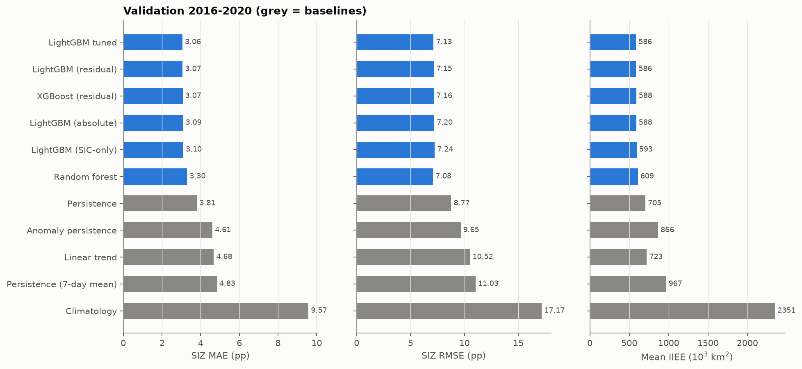
*Validation (2016-2020) full-grid comparison of baselines and ML candidates: MAE and RMSE over the seasonal ice zone (cells whose training climatology reaches 15 %) and mean integrated ice-edge error.*

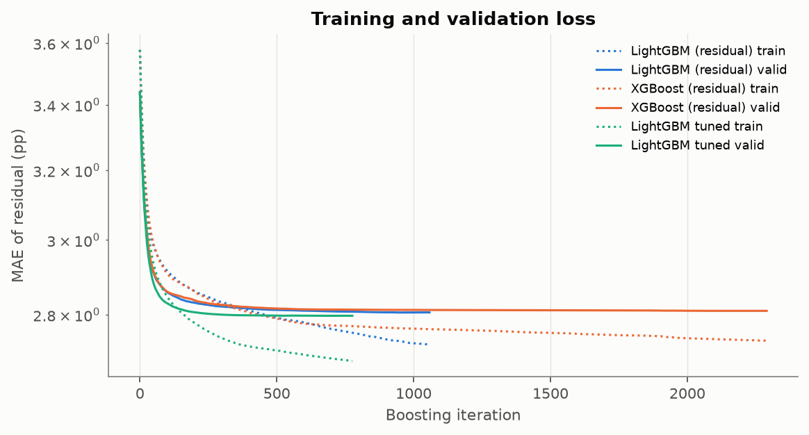
*Training (dotted) and validation (solid) L1 loss of the boosted models on the sampled tables; early stopping at the validation minimum.*

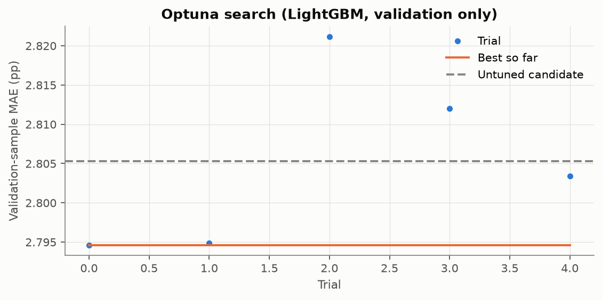
*Optuna TPE trials: validation-sample MAE of each configuration and the running best.*

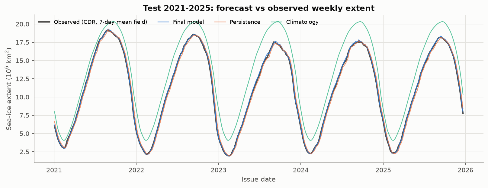
*Weekly sea-ice extent (SIC >= 15 %) of the observed 7-day-mean field and of the forecasts for every test issue date.*

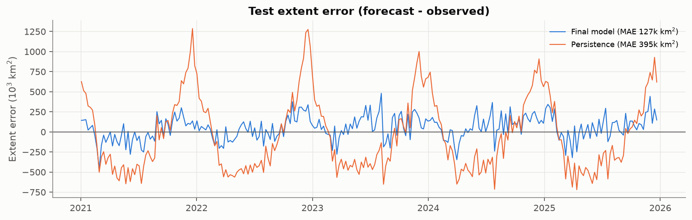
*Extent error per test issue date for the final model and persistence.*

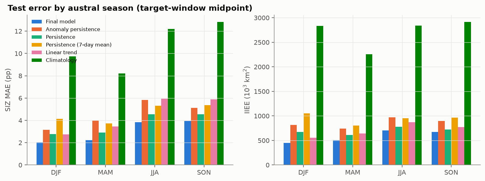
*Test-period MAE (seasonal ice zone) and IIEE by season; DJF = austral summer melt minimum.*

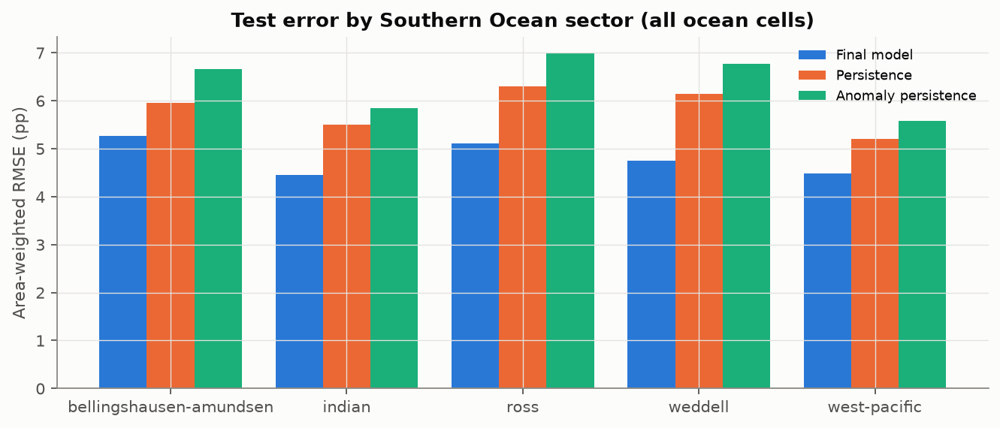
*Area-weighted RMSE per sector (NSIDC sector definitions) over all valid ocean cells.*

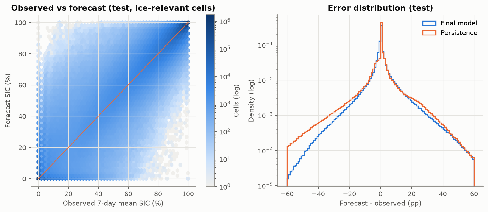
*Left: joint distribution of observed and forecast SIC on cells where any of observation, forecast or persistence is non-zero. Right: error distributions of the final model and persistence.*

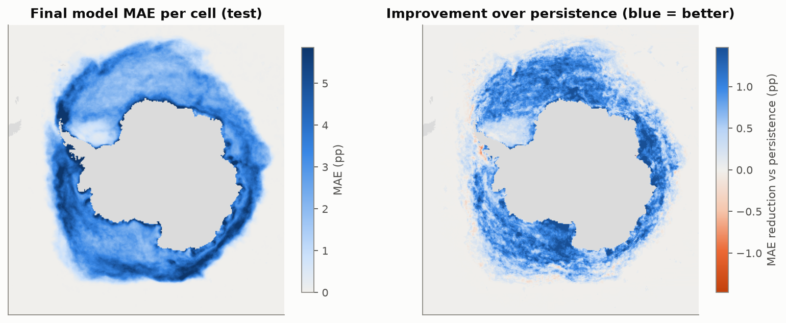
*Per-cell mean absolute error of the final model over all test issue dates and its reduction relative to persistence (native EPSG:3412 grid; grey = land/coast).*

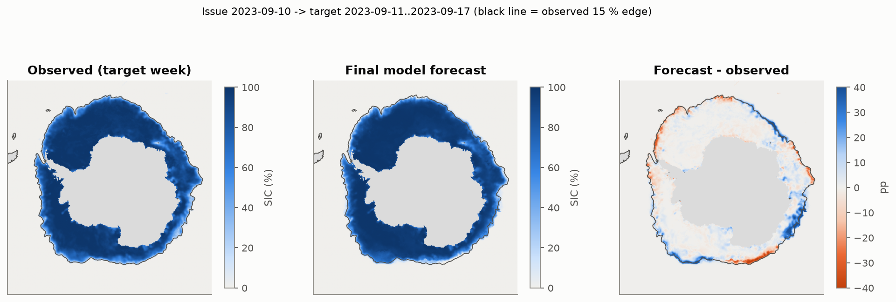
*Example test forecast near the 2023 record-low winter maximum: observed target-week mean SIC, forecast and difference, with the observed 15 % ice edge.*

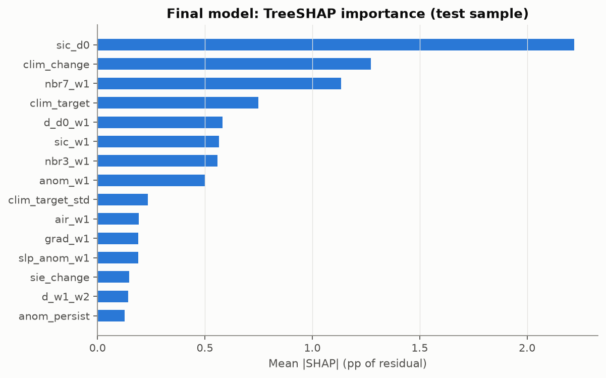
*Mean absolute TreeSHAP contribution of the 15 most influential features of the final model on a random sample of test-period cells.*

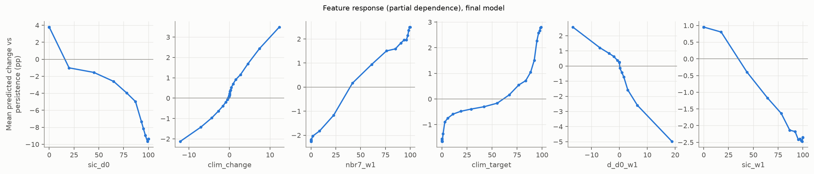
*Partial dependence of the predicted change relative to persistence on the top features.*

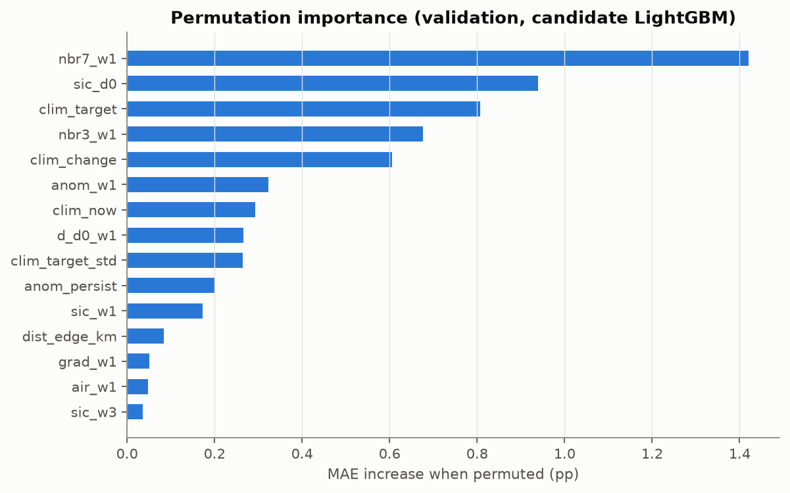
*Increase in MAE when each feature is randomly permuted (validation sample, candidate LightGBM trained on 1979-2015).*
