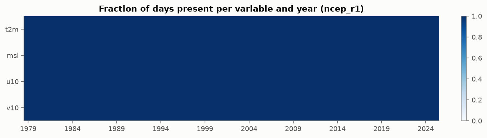
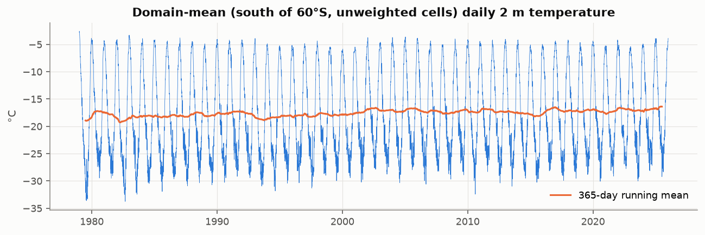
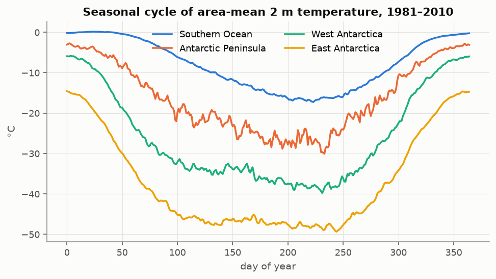
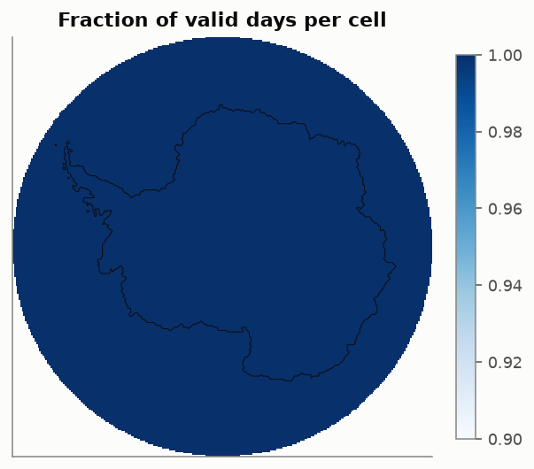
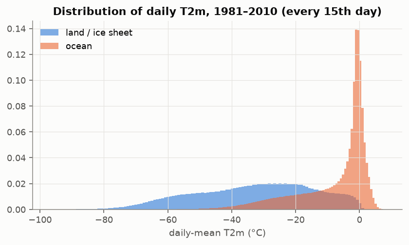
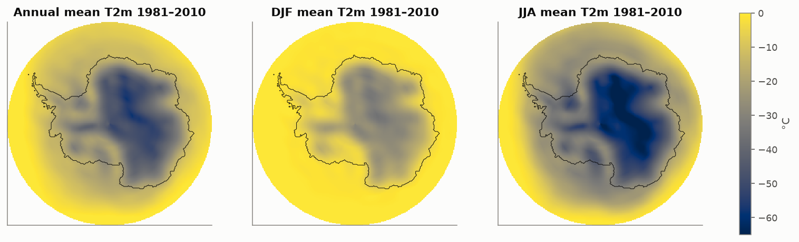
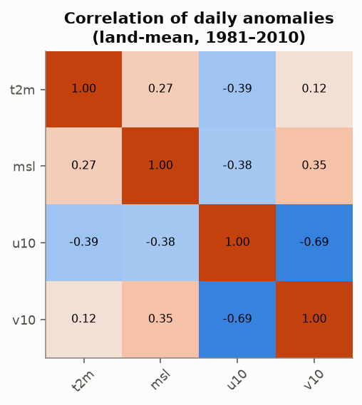

# AETHENTRA ML-02 — Data Quality Report

Source: `ncep_r1`. **Truth = NCEP/NCAR Reanalysis 1 (interim substitute for ERA5).** All skill numbers below are agreement with NCEP R1, not with ERA5 and not with direct observations.

## Cube

* 55,512 cells south of 60°S (21,691 land / ice shelf), 17,167 days 1979-01-01 … 2025-12-31; cells with any missing day: 0.
* Orography: https://psl.noaa.gov/thredds/dodsC/Datasets/ncep.reanalysis/surface_gauss/hgt.sfc.gauss.nc.

| variable | units | conversion | days present | impossible → missing | doubtful (kept) | flag range | duplicates dropped | files |
|---|---|---|---|---|---|---|---|---|
| t2m | degC | degK -> degC (minus 273.15) | 17,167 | 0 | 32,739 | [-89.2, 20] | 0 | 47 |
| msl | hPa | Pa -> hPa | 17,167 | 0 | 113,324 | [870, 1090] | 0 | 47 |
| u10 | m s-1 | unchanged (m/s) | 17,167 | 0 | 0 | None | 0 | 47 |
| v10 | m s-1 | unchanged (m/s) | 17,167 | 0 | 0 | None | 0 | 47 |

* Raw files checked: 192 (units in files: msl: Pascals, t2m: degK, u10: m/s, v10: m/s).
* Raw-file issues: 1 — data/raw/aethentra/ncep_r1/ncep_r1_uwnd_2026_south.nc (non-monotonic time 1, NaN fraction 0.79, 2025-03-18…2026-03-17).
  The ML-01 file `ncep_r1_uwnd_2026_south.nc` carries 289 all-NaN placeholder steps mislabelled 2025-03-18…2025-12-31 after the 76 valid 2026 days. ML-02 reads only 1979–2025 files, and the ML-01 loader keeps the first (valid 2025-file) value of duplicated dates, so no valid value is overwritten.
* Domain-mean daily T2m jumps > 8.0 °C: ['1997-08-07']. 1997-08-07: +8.6 °C domain mean (ocean +12.7 °C, single cells up to +43 °C; next-largest jump on record 2.8 °C) — treated as a reanalysis boundary-condition artefact; issue dates whose input or target windows overlap 1997-08-06…10 are excluded (9 training dates).
* Daily T2m percentiles 1981–2010 (every 15th day): p0.1 -80.1 °C, p1 -68.8 °C, p50 -11.4 °C, p99 3.6 °C, p99.9 5.4 °C.

### Seasonal cycle 1981–2010 (area-mean °C)

| region | min | mean | max |
|---|---|---|---|
| Southern Ocean | -17.3 | -7.9 | 0.1 |
| Antarctic Peninsula | -30.1 | -16.2 | -2.7 |
| West Antarctica | -39.8 | -25.9 | -5.9 |
| East Antarctica | -49.3 | -37.0 | -14.6 |

Correlation of land-mean daily anomalies between variables: t2m–u10 -0.40, t2m–v10 +0.12, msl–t2m +0.27, msl–u10 -0.38, msl–v10 +0.35, u10–v10 -0.69.

## Stations

47 stations (16 Zenodo 17164992, 31 GHCN-Daily not duplicating them). Zenodo series end in 2022; GHCN to 2026.

| station | lat | lon | elev m | first | last | days | share of 2018–2025 days |
|---|---|---|---|---|---|---|---|
| AMUNDSEN-SCOTT (zenodo) | -90.00 | 0.00 | -1000 | 1957-01-11 | 2022-04-01 | 23,819 | 0.53 |
| CASEY (zenodo) | -66.28 | 110.52 | 41 | 1969-02-21 | 2022-03-31 | 19,392 | 0.53 |
| CONCORDIA (zenodo) | -75.10 | 123.40 | 3233 | 1980-02-05 | 2022-04-30 | 14,722 | 0.52 |
| DAVIS (zenodo) | -68.58 | 77.95 | 13 | 1957-02-10 | 2022-04-01 | 22,166 | 0.52 |
| DUMONT D'URVILLE (zenodo) | -66.67 | 140.02 | 43 | 1956-04-01 | 2022-06-30 | 24,137 | 0.56 |
| BASE ESPERANZA (zenodo) | -63.40 | -56.98 | 24 | 1957-01-01 | 2022-11-29 | 21,828 | 0.61 |
| HALLEY (zenodo) | -75.45 | -26.22 | 30 | 1957-01-01 | 2022-04-21 | 23,846 | 0.54 |
| BASE MARAMBIO (zenodo) | -64.23 | -56.72 | 198 | 1971-01-01 | 2022-11-29 | 18,771 | 0.61 |
| MAWSON (zenodo) | -67.60 | 62.87 | 16 | 1954-02-23 | 2022-11-29 | 25,117 | 0.61 |
| MCMURDO SOUND NAF (zenodo) | -77.88 | 166.73 | 24 | 1956-03-09 | 2022-11-29 | 23,933 | 0.60 |
| NEUMAYER (zenodo) | -70.67 | -8.25 | 50 | 1981-01-28 | 2022-11-29 | 15,272 | 0.61 |
| NOVOLAZAREVSKAJA (zenodo) | -70.77 | 11.83 | 119 | 1961-02-01 | 2022-11-29 | 21,927 | 0.61 |
| ROTHERA (zenodo) | -67.57 | -68.12 | 33 | 1976-03-08 | 2022-04-21 | 16,790 | 0.54 |
| SYOWA (zenodo) | -69.00 | 39.58 | 21 | 1966-02-01 | 2022-11-29 | 20,753 | 0.61 |
| VERNADSKY (zenodo) | -65.25 | -64.27 | 11 | 1947-01-15 | 2022-03-31 | 27,387 | 0.51 |
| VOSTOK (zenodo) | -78.45 | 106.87 | 3488 | 1958-01-01 | 2022-04-09 | 21,934 | 0.53 |
| BASE ORCADAS (ghcnd) | -60.73 | -44.73 | 8 | 1973-01-01 | 2026-11-01 | 17,734 | 0.97 |
| BASE BELGRANO II (ghcnd) | -77.87 | -34.62 | 256 | 1956-09-01 | 2026-11-01 | 14,184 | 0.99 |
| BELLINGSHAUSEN AWS (ghcnd) | -62.18 | -58.88 | 14 | 1973-01-01 | 2026-11-01 | 14,837 | 0.94 |
| BASE JUBANY (ghcnd) | -62.23 | -58.63 | 11 | 1981-01-02 | 2026-11-01 | 14,221 | 0.99 |
| DINAMET-URUGUAY (ghcnd) | -62.18 | -58.85 | 17 | 1985-03-03 | 2026-11-01 | 9,435 | 0.23 |
| CENTRO MET. ANTARTICO PDTE. E (ghcnd) | -62.18 | -58.98 | 48 | 1985-04-09 | 2026-11-01 | 14,474 | 0.99 |
| BASE ARTURO PRAT (ghcnd) | -62.50 | -59.68 | 5 | 1985-07-01 | 2026-10-27 | 12,653 | 0.97 |
| GREAT WALL (ghcnd) | -62.22 | -58.97 | 10 | 1986-01-02 | 2026-11-01 | 10,286 | 0.66 |
| BASE BERNARDO O'HIGGINS (ghcnd) | -63.32 | -56.68 | 10 | 1985-07-01 | 2026-10-27 | 13,559 | 0.93 |
| PALMER STATION (ghcnd) | -64.77 | -64.08 | 8 | 1976-08-16 | 2025-08-24 | 8,575 | 0.94 |
| BASE SAN MARTIN (ghcnd) | -68.12 | -67.13 | 7 | 1976-10-09 | 2026-11-01 | 16,619 | 0.99 |
| UNIV. WI ID 8926 (LARSEN ICE (ghcnd) | -67.02 | -61.47 | 45 | 1990-05-12 | 2025-05-04 | 8,781 | 0.60 |
| UNIV. WI ID 8902 (BUTLER ISLA (ghcnd) | -72.20 | -60.17 | 115 | 1990-05-10 | 2026-11-01 | 10,666 | 0.82 |
| BYRD STATION (ghcnd) | -80.00 | -119.40 | 1530 | 1990-05-10 | 2021-11-08 | 5,411 | 0.29 |
| LETTAU (ghcnd) | -82.52 | -174.45 | 55 | 1990-05-10 | 2021-11-08 | 6,205 | 0.29 |
| MAITRI (ghcnd) | -70.77 | 11.75 | -1000 | 1990-02-03 | 2026-11-01 | 5,797 | 0.02 |
| MOLODEZNAJA (ghcnd) | -67.67 | 45.85 | 50 | 1973-01-02 | 2026-11-01 | 8,958 | 0.77 |
| ZHONGSHAN (ghcnd) | -69.37 | 76.37 | 18 | 1990-03-10 | 2026-11-01 | 6,951 | 0.81 |
| PROGRESS (ghcnd) | -69.38 | 76.38 | 64 | 1988-04-01 | 2026-11-01 | 8,591 | 0.92 |
| MIRNYJ (ghcnd) | -66.55 | 93.02 | 40 | 1973-01-01 | 2026-11-01 | 15,335 | 0.92 |
| LENINGRADSKAYA (ghcnd) | -69.50 | 159.38 | 291 | 1973-01-01 | 2023-01-29 | 4,442 | 0.01 |
| PEGASUS NORTH (ghcnd) | -77.95 | 166.50 | 10 | 1990-05-10 | 2021-02-13 | 5,400 | 0.00 |
| DOME C II (ghcnd) | -75.12 | 123.37 | 3250 | 1990-05-10 | 2026-11-01 | 11,940 | 0.97 |
| D-10 (ghcnd) | -66.72 | 139.83 | 243 | 1990-05-12 | 2021-11-08 | 3,256 | 0.24 |
| D-47 (ghcnd) | -67.40 | 138.73 | 1560 | 1990-05-12 | 2021-11-08 | 3,481 | 0.23 |
| MANUELA (ghcnd) | -74.95 | 163.68 | 80 | 1990-05-10 | 2021-11-08 | 8,472 | 0.28 |
| WHITLOCK (ghcnd) | -76.13 | 168.38 | 274 | 1990-05-10 | 2021-11-08 | 2,728 | 0.28 |
| SCHWERDTFEGER (ghcnd) | -79.90 | 169.98 | 60 | 1990-05-10 | 2021-11-08 | 7,578 | 0.29 |
| MARILYN (ghcnd) | -79.95 | 165.12 | 75 | 1990-05-13 | 2021-07-31 | 6,752 | 0.23 |
| FERRELL (ghcnd) | -77.90 | 170.82 | 45 | 1990-05-10 | 2021-11-08 | 5,722 | 0.29 |
| MARBLE POINT (ghcnd) | -77.42 | 163.68 | 48 | 1990-05-12 | 2025-08-24 | 11,921 | 0.95 |

Elevation −999.9 = not given in the GHCN station list.

## Figures

