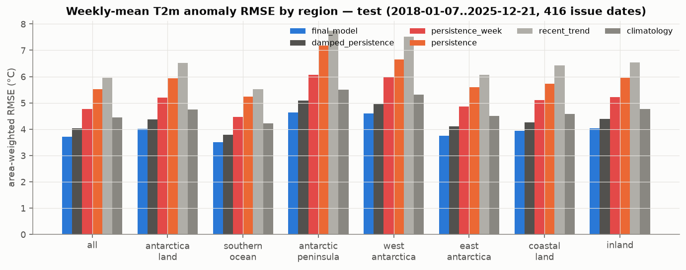
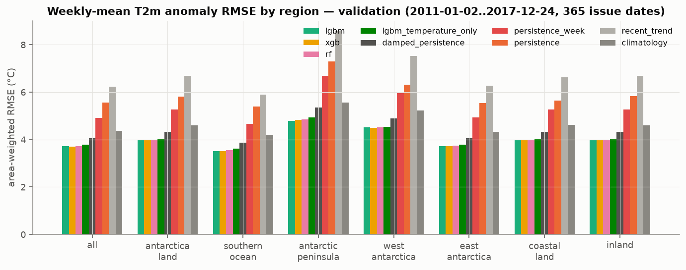
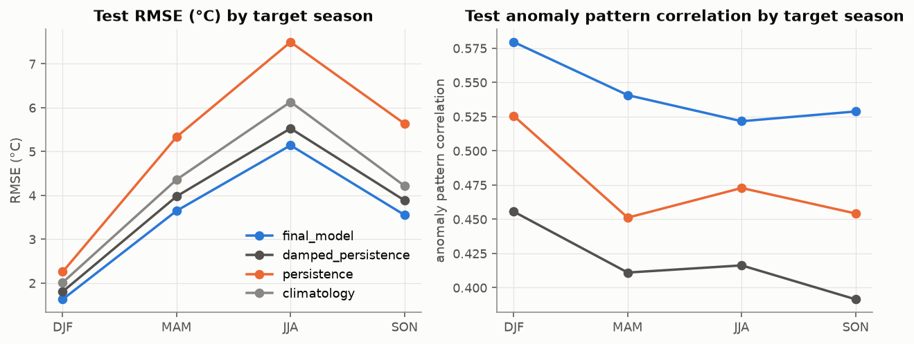
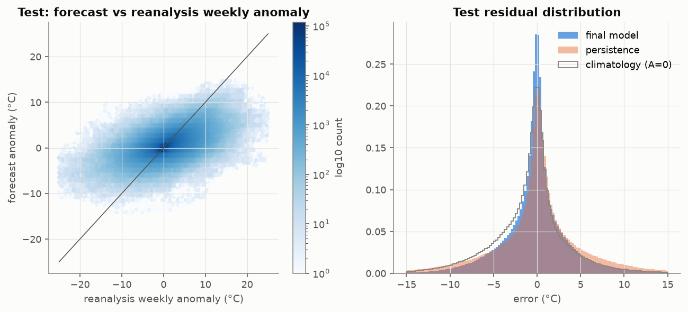
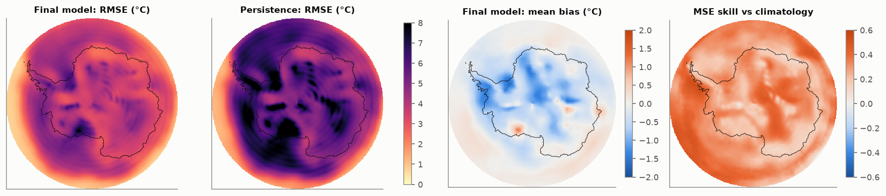
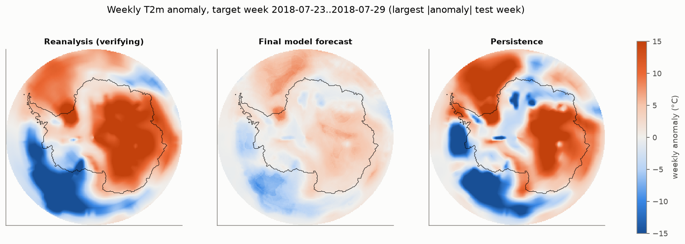
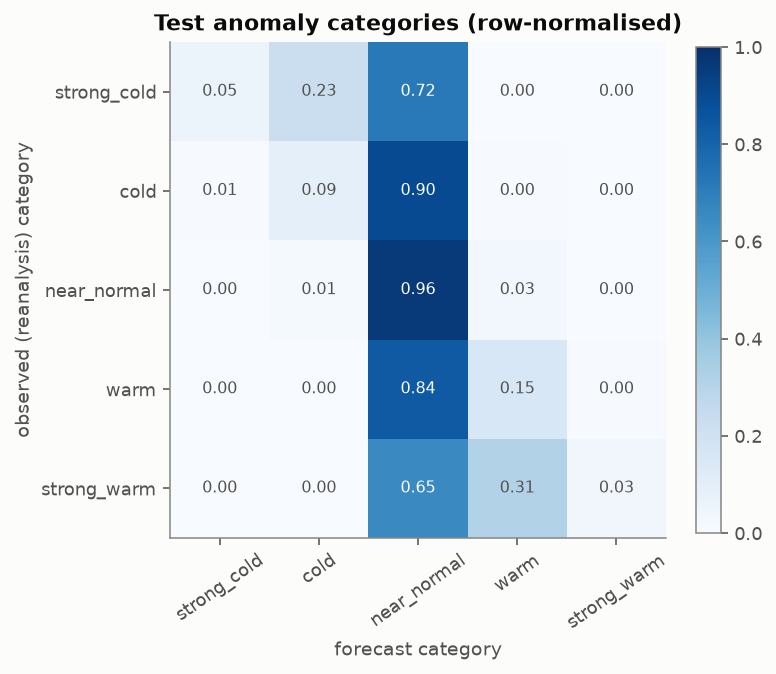
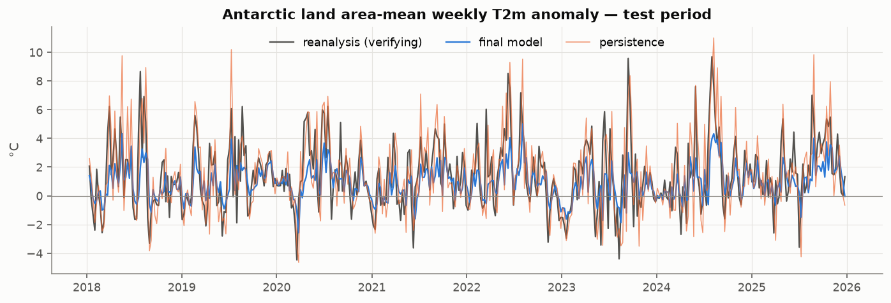
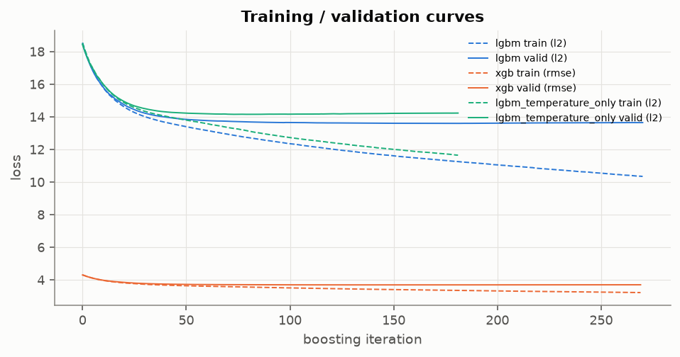
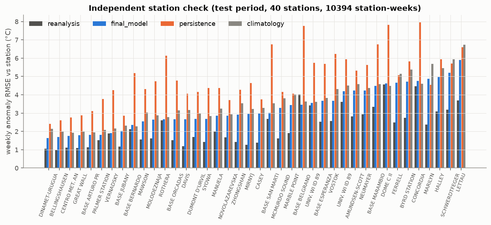

# AETHENTRA ML-02 — Model Evaluation Report

**Truth = NCEP/NCAR Reanalysis 1 (interim substitute for ERA5).** All skill numbers below are agreement with NCEP R1, not with ERA5 and not with direct observations.

Metrics are area-weighted over all cells of every issue date (no sampling). MAE/RMSE/bias are identical for absolute T2m and for the anomaly (same climatology on both sides); R² and correlations are given for both. ACC = mean over issue dates of the area-weighted uncentred anomaly pattern correlation. MSSS = 1 − MSE / MSE(climatology forecast).

## Validation 2011-01-02 … 2017-12-24 (365 issue dates)

| model | MAE °C | RMSE °C | bias °C | ACC | corr | MSSS vs clim | R² anom | R² T2m |
|---|---|---|---|---|---|---|---|---|
| lgbm_tuned | 2.487 | 3.704 | -0.234 | 0.534 | 0.526 | 0.280 | 0.274 | 0.958 |
| lgbm | 2.491 | 3.711 | -0.233 | 0.531 | 0.524 | 0.278 | 0.271 | 0.957 |
| xgb | 2.487 | 3.708 | -0.232 | 0.534 | 0.524 | 0.279 | 0.272 | 0.958 |
| rf | 2.499 | 3.730 | -0.264 | 0.527 | 0.518 | 0.270 | 0.263 | 0.957 |
| lgbm_temperature_only | 2.544 | 3.785 | -0.194 | 0.507 | 0.494 | 0.248 | 0.241 | 0.956 |
| climatology | 2.977 | 4.366 | -0.438 | n/a | n/a | 0.000 | -0.009 | 0.941 |
| persistence | 3.686 | 5.560 | -0.038 | 0.469 | 0.456 | -0.622 | -0.642 | 0.904 |
| persistence_week | 3.275 | 4.917 | -0.001 | 0.379 | 0.360 | -0.268 | -0.281 | 0.925 |
| recent_trend | 4.151 | 6.219 | 0.003 | 0.332 | 0.313 | -1.029 | -1.049 | 0.880 |
| damped_persistence | 2.740 | 4.059 | -0.300 | 0.382 | 0.363 | 0.136 | 0.128 | 0.949 |

### Validation RMSE (°C) by region

| model | all | antarctica_land | southern_ocean | antarctic_peninsula | west_antarctica | east_antarctica | coastal_land | inland |
|---|---|---|---|---|---|---|---|---|
| lgbm_tuned | 3.704 | 3.967 | 3.514 | 4.811 | 4.490 | 3.724 | 3.965 | 3.967 |
| lgbm | 3.711 | 3.973 | 3.521 | 4.788 | 4.512 | 3.725 | 3.965 | 3.974 |
| xgb | 3.708 | 3.971 | 3.518 | 4.827 | 4.497 | 3.726 | 3.967 | 3.971 |
| rf | 3.730 | 3.981 | 3.549 | 4.850 | 4.516 | 3.731 | 3.977 | 3.981 |
| lgbm_temperature_only | 3.785 | 4.021 | 3.616 | 4.941 | 4.545 | 3.773 | 4.011 | 4.022 |
| climatology | 4.366 | 4.607 | 4.194 | 5.566 | 5.233 | 4.318 | 4.621 | 4.605 |
| persistence | 5.560 | 5.807 | 5.385 | 7.285 | 6.317 | 5.540 | 5.639 | 5.831 |
| persistence_week | 4.917 | 5.272 | 4.660 | 6.681 | 5.951 | 4.938 | 5.255 | 5.274 |
| recent_trend | 6.219 | 6.681 | 5.884 | 8.580 | 7.512 | 6.264 | 6.632 | 6.689 |
| damped_persistence | 4.059 | 4.327 | 3.865 | 5.358 | 4.898 | 4.056 | 4.335 | 4.326 |

Validation q10–q90 interval: empirical coverage 0.763 (nominal 0.80) over 365 issue dates, mean width 7.31 °C.

## Test 2018-01-07 … 2025-12-21 (416 issue dates, evaluated once, 2026-11-07T23:45:07.364854+00:00)

| model | MAE °C | RMSE °C | bias °C | ACC | corr | MSSS vs clim | R² anom | R² T2m |
|---|---|---|---|---|---|---|---|---|
| final_model | 2.471 | 3.719 | -0.253 | 0.542 | 0.531 | 0.299 | 0.278 | 0.957 |
| climatology | 2.999 | 4.441 | -0.781 | n/a | n/a | 0.000 | -0.030 | 0.938 |
| persistence | 3.644 | 5.527 | -0.012 | 0.476 | 0.473 | -0.549 | -0.597 | 0.904 |
| persistence_week | 3.162 | 4.775 | 0.000 | 0.416 | 0.405 | -0.156 | -0.190 | 0.929 |
| recent_trend | 3.955 | 5.949 | -0.003 | 0.367 | 0.363 | -0.794 | -0.846 | 0.889 |
| damped_persistence | 2.702 | 4.033 | -0.514 | 0.418 | 0.407 | 0.175 | 0.151 | 0.949 |

### Skill of the final model (1 − MSE/MSE_ref, area-weighted)

| region | vs climatology | vs persistence | vs damped persistence | RMSE final | RMSE persistence |
|---|---|---|---|---|---|
| all | 0.299 | 0.547 | 0.150 | 3.719 | 5.527 |
| antarctica_land | 0.285 | 0.541 | 0.156 | 4.014 | 5.928 |
| southern_ocean | 0.311 | 0.552 | 0.144 | 3.504 | 5.236 |
| antarctic_peninsula | 0.289 | 0.583 | 0.166 | 4.643 | 7.187 |
| west_antarctica | 0.250 | 0.521 | 0.138 | 4.601 | 6.645 |
| east_antarctica | 0.301 | 0.548 | 0.164 | 3.757 | 5.591 |
| coastal_land | 0.264 | 0.528 | 0.146 | 3.935 | 5.729 |
| inland | 0.288 | 0.543 | 0.157 | 4.025 | 5.956 |

### Test by season (all cells)

| model | DJF RMSE | DJF ACC | MAM RMSE | MAM ACC | JJA RMSE | JJA ACC | SON RMSE | SON ACC |
|---|---|---|---|---|---|---|---|---|
| final_model | 1.628 | 0.579 | 3.647 | 0.541 | 5.141 | 0.522 | 3.552 | 0.529 |
| climatology | 2.012 | n/a | 4.360 | n/a | 6.131 | n/a | 4.217 | n/a |
| persistence | 2.255 | 0.525 | 5.334 | 0.451 | 7.496 | 0.473 | 5.635 | 0.454 |
| persistence_week | 2.109 | 0.456 | 4.620 | 0.402 | 6.486 | 0.414 | 4.776 | 0.392 |
| recent_trend | 2.576 | 0.405 | 5.710 | 0.353 | 8.066 | 0.372 | 6.036 | 0.341 |
| damped_persistence | 1.804 | 0.456 | 3.977 | 0.411 | 5.526 | 0.416 | 3.884 | 0.391 |

### Warm / cold anomaly detection (test, all cells, cell-week counts)

| model | balanced acc. | warm P/R/F1 | cold P/R/F1 | extreme warm P/R/F1 | extreme cold P/R/F1 |
|---|---|---|---|---|---|
| final_model | 0.259 | 0.65/0.19/0.30 | 0.59/0.13/0.22 | 0.59/0.03/0.07 | 0.55/0.05/0.10 |
| climatology | 0.200 | nan/0.00/nan | nan/0.00/nan | nan/0.00/nan | nan/0.00/nan |
| persistence | 0.415 | 0.40/0.55/0.46 | 0.30/0.48/0.37 | 0.19/0.45/0.27 | 0.14/0.38/0.20 |
| persistence_week | 0.339 | 0.40/0.40/0.40 | 0.33/0.33/0.33 | 0.21/0.22/0.21 | 0.20/0.19/0.19 |
| recent_trend | 0.353 | 0.34/0.47/0.40 | 0.26/0.41/0.32 | 0.14/0.33/0.19 | 0.11/0.28/0.16 |
| damped_persistence | 0.214 | 0.59/0.04/0.08 | 0.49/0.05/0.09 | 0.59/0.01/0.01 | 0.43/0.01/0.03 |

Test q10–q90 interval: empirical coverage 0.768 vs nominal 0.80, mean width 7.18 °C → interval **exported** (rule: within ±5 pp).

## Independent station check (test period; 40 stations, 10,394 station-weeks)

Station anomalies vs each station's own 1981-2010 climatology; nearest 25 km cell (land preferred). Reanalysis assimilates many of these stations -> partially independent.

| forecast | anomaly MAE °C | anomaly RMSE °C | correlation |
|---|---|---|---|
| reanalysis | 1.636 | 2.394 | 0.783 |
| final_model | 2.279 | 3.196 | 0.389 |
| persistence | 3.570 | 5.097 | 0.381 |
| climatology | 2.480 | 3.479 | n/a |

`reanalysis` = the verifying gridded truth itself at the nearest cell: its disagreement with stations is a floor for any model trained on it.

## Figures

