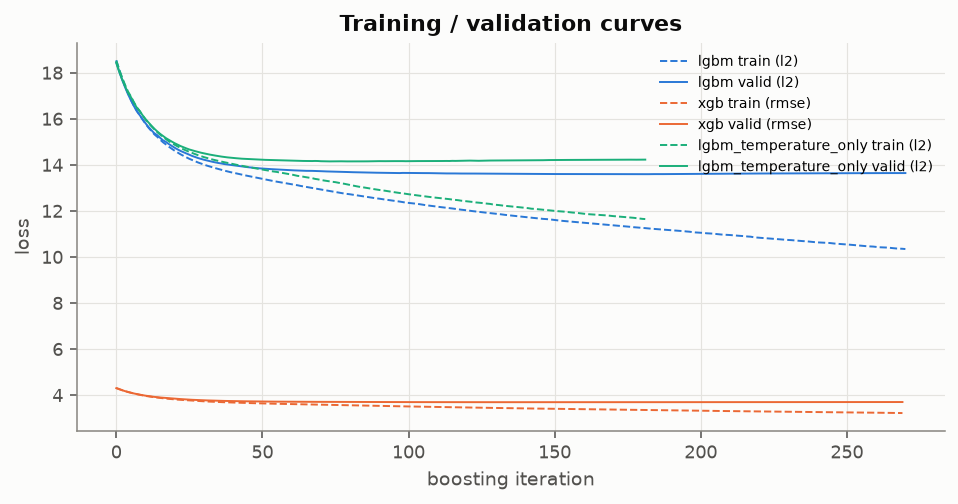

# AETHENTRA ML-02 — Model Training Report

**Truth = NCEP/NCAR Reanalysis 1 (interim substitute for ERA5).** All skill numbers below are agreement with NCEP R1, not with ERA5 and not with direct observations.

## Protocol

* Chronological splits: train ['1979-01-01', '2010-12-31'], validation ['2011-01-01', '2017-12-31'], test ['2018-01-01', '2025-12-31'] (issue dates every 7 days; a target window never crosses a split boundary; suspect-period dates excluded).
* Training rows: 4% of valid cells per training issue date; validation table 15% per date (early stopping and Optuna only). Model selection uses full-grid validation metrics (every cell, every validation issue date).
* Target: weekly T2m anomaly (label B); absolute T2m = target-week climatology + prediction.
* Spatial deep learning: see the U-Net addendum section below (run after the tree selection and test were frozen).

* Table `train`: 3,671,465 rows from 1652 issue dates (1979-02-25 … 2010-12-19), 37 features.
* Table `validation`: 3,037,913 rows from 365 issue dates (2011-01-02 … 2017-12-24), 37 features.

## U-Net addendum (spatial deep-learning candidate)

* U-Net (`cnn_unet`): 7,772,545 parameters, 33 epochs, best epoch 25 (validation rmse 3.549), 33 min on cuda; 28 dynamic + 7 static channels; loss mse.

| criterion (validation) | U-Net | lgbm_tuned | U-Net better |
|---|---|---|---|
| all:area_weighted_rmse_degC | 3.549 | 3.704 | yes |
| antarctica_land:area_weighted_rmse_degC | 3.825 | 3.967 | yes |
| all:acc_pattern_mean | 0.577 | 0.534 | yes |
| all:area_weighted_mae_degC | 2.389 | 2.487 | yes |

* Decision (frozen 2026-11-09T01:31:53.185951+00:00, validation only): U-Net better on 4/4 selection metrics; replaces the operational model: **True** (the U-Net replaces the operational model only if it is better on ALL validation selection metrics).
* Single test evaluation of `test_cnn_addendum` (416 issue dates, 2018-01-07 … 2025-12-21, evaluated 2026-11-09T02:08:24.488992+00:00):

| test metric | U-Net | tree final model |
|---|---|---|
| MAE (°C) | 2.366 | 2.471 |
| RMSE (°C) | 3.549 | 3.719 |
| ACC | 0.587 | 0.542 |
| MSSS | 0.361 | 0.299 |

## Candidates (training records from the saved checkpoint metadata)

| model | kind | features | train rows | best iteration / trees | fit s | RSS GB after | key parameters |
|---|---|---|---|---|---|---|---|
| lgbm | lightgbm | 37 | 3,671,465 | 171 | 94 | 2.07 | {'objective': 'regression', 'learning_rate': 0.05, 'num_leaves': 127, 'min_data_in_leaf': 200, 'n_estimators': 3000} |
| lgbm_temperature_only | lightgbm | 29 | 3,671,465 | 82 | 32 | 2.04 | {'objective': 'regression', 'learning_rate': 0.05, 'num_leaves': 127, 'min_data_in_leaf': 200, 'n_estimators': 3000} |
| xgb | xgboost | 37 | 3,671,465 | 170 | 18 | 2.22 | {'objective': 'reg:squarederror', 'learning_rate': 0.05, 'max_depth': 8, 'min_child_weight': 50, 'n_estimators': 3000} |
| rf | random_forest | 37 | 400,000 | 100 | 61 | 2.34 | {'n_estimators': 100, 'max_depth': 20, 'min_samples_leaf': 50, 'max_features': 0.5, 'max_train_rows': 400000} |
| lgbm_q10 | lightgbm q=0.1 | 37 | 3,671,465 | 249 | 69 | 2.32 | {'objective': 'quantile (alpha=0.1; set at fit time)', 'learning_rate': 0.05, 'num_leaves': 127, 'min_data_in_leaf': 200, 'n_estimators': 3000} |
| lgbm_q90 | lightgbm q=0.9 | 37 | 3,671,465 | 171 | 91 | 2.31 | {'objective': 'quantile (alpha=0.9; set at fit time)', 'learning_rate': 0.05, 'num_leaves': 127, 'min_data_in_leaf': 200, 'n_estimators': 3000} |

## Optuna (LightGBM, validation sample only)

* Objective: RMSE (degC) of weekly anomaly on the validation sample. Trials completed 12, failed 0 (budget 15 trials / 1500 s).
* Best 3.6791 °C vs untuned LightGBM 3.6857 °C; best params {'learning_rate': 0.026096797290981667, 'num_leaves': 75, 'min_data_in_leaf': 1278, 'feature_fraction': 0.5888169345217917, 'bagging_fraction': 0.5327514368407912, 'lambda_l2': 0.15686572026436765}, best iteration 389.

## Selection (frozen before the test)

* Selected: **lgbm_tuned** — validation 2011-2017 full-grid, rank-sum of all:area_weighted_rmse_degC, antarctica_land:area_weighted_rmse_degC, all:acc_pattern_mean, all:area_weighted_mae_degC.
* Rank sums: {'lgbm_tuned': 5, 'xgb': 7, 'lgbm': 12, 'rf': 16, 'lgbm_temperature_only': 20, 'damped_persistence': 25, 'climatology': 31, 'persistence_week': 32, 'persistence': 33, 'recent_trend': 39}.
* Best baseline on validation: damped_persistence; selected model beats it on every selection metric: True.
* Frozen 2026-11-07T23:32:43.329940+00:00; test accessed before selection: False.

## Final refit

* `final_model` (lightgbm, from `lgbm_tuned`), trained on ['1979-01-01', '2017-12-31'] (4,480,839 rows; validation rows thinned to the training sampling density), 428 iterations (1.1 × validation best iteration, no early stopping), quantile models q10/q90 refitted the same way.
* Model version `aethentra-t2m-weekly-20261108-v1`; climatology ['1981', '2010']; files in `models/ml02/final/`.

## Learning curves

