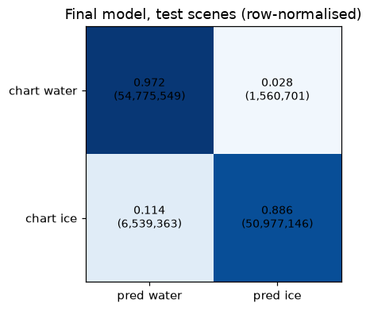
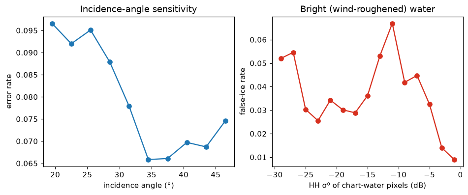
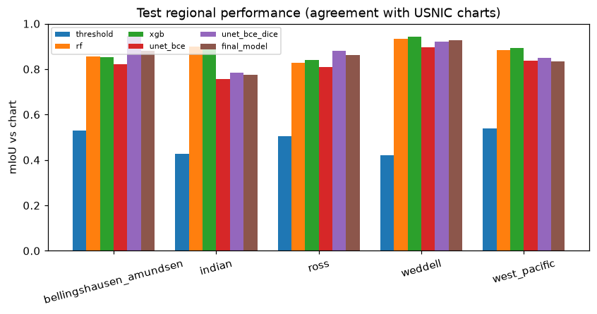
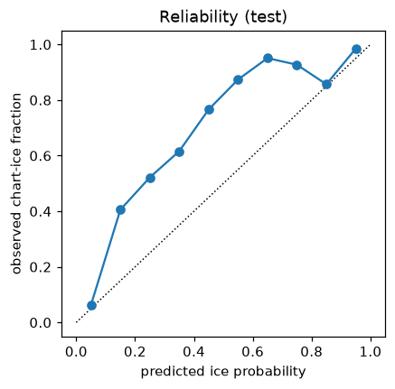
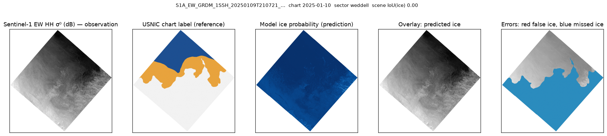
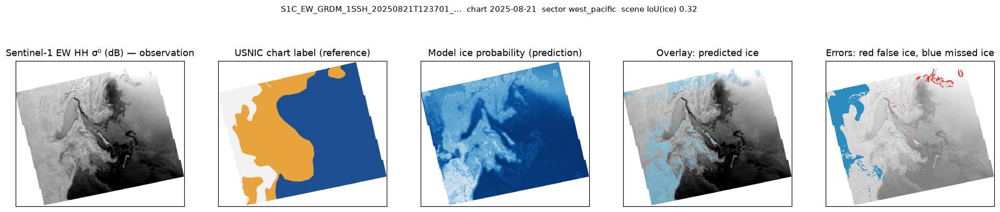
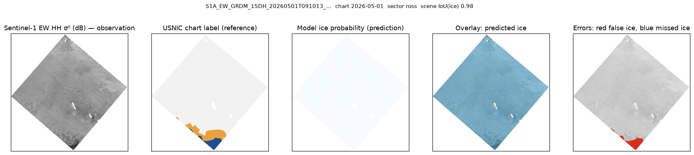
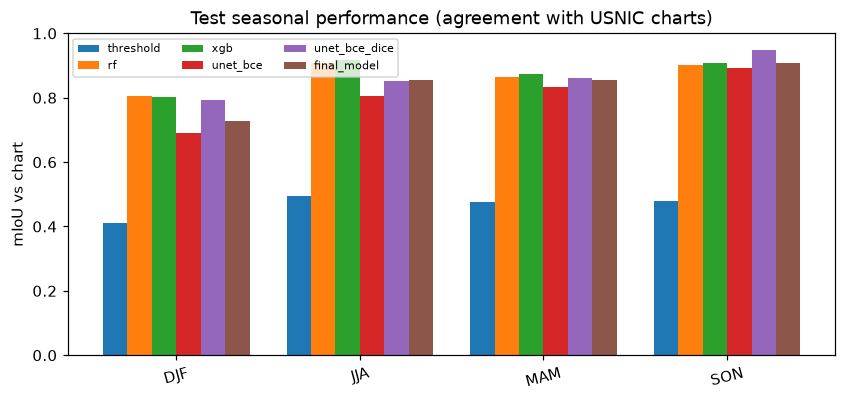
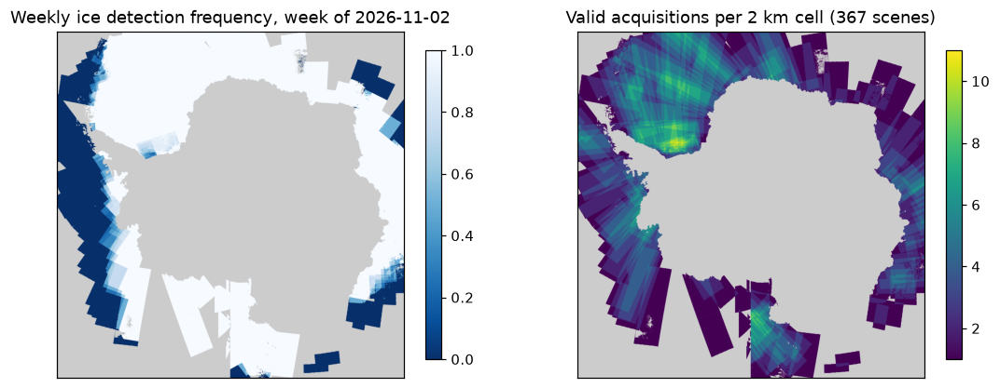

# ML-03 — Model Evaluation Report

**All metrics measure agreement with USNIC chart labels** on full scenes (water/ice pixels only; uncertain and invalid pixels excluded). Boundary metrics use the unbuffered chart ice edge (≥ 10 % concentration) with a 2 km tolerance. Ice areas use true pixel areas.

## Validation (106 scenes, charts 2023-01-05…2024-12-30)

| model | mIoU | IoU ice | IoU water | F1 ice | prec. ice | recall ice | OA | bal. acc. | boundary F1 | edge disp. km | ice-area bias % |
|---|---|---|---|---|---|---|---|---|---|---|---|
| threshold | 0.480 | 0.625 | 0.335 | 0.769 | 0.707 | 0.843 | 0.685 | 0.633 | 0.039 | 98.740 | 17.7 |
| rf | 0.877 | 0.908 | 0.845 | 0.952 | 0.932 | 0.973 | 0.939 | 0.928 | 0.056 | 93.580 | 4.2 |
| xgb | 0.867 | 0.902 | 0.832 | 0.948 | 0.925 | 0.973 | 0.934 | 0.921 | 0.066 | 82.052 | 5.0 |
| unet_bce | 0.834 | 0.861 | 0.807 | 0.925 | 0.984 | 0.873 | 0.912 | 0.925 | 0.041 | 95.462 | -11.0 |
| unet_bce_dice | 0.886 | 0.910 | 0.861 | 0.953 | 0.967 | 0.939 | 0.942 | 0.943 | 0.042 | 89.029 | -2.8 |

**Selection (frozen 2026-11-09T17:21:01.946458+00:00, validation only):** `unet_bce_dice` — rank-sum on validation full scenes: mIoU, ice F1, boundary F1, |ice-area bias| (ties -> simpler). Rank sums: unet_bce_dice 6, rf 8, xgb 10, unet_bce 16, threshold 20.

## Test — single evaluation (157 scenes, charts 2025-01-03…2026-10-29, evaluated 2026-11-09T18:18:30.738110+00:00)

| model | mIoU | IoU ice | IoU water | F1 ice | prec. ice | recall ice | OA | bal. acc. | boundary F1 | edge disp. km | ice-area bias % |
|---|---|---|---|---|---|---|---|---|---|---|---|
| threshold | 0.487 | 0.556 | 0.417 | 0.715 | 0.624 | 0.836 | 0.663 | 0.661 | 0.044 | 90.678 | 32.2 |
| rf | 0.890 | 0.894 | 0.887 | 0.944 | 0.926 | 0.963 | 0.942 | 0.942 | 0.057 | 66.097 | 3.9 |
| xgb | 0.896 | 0.898 | 0.893 | 0.946 | 0.932 | 0.961 | 0.945 | 0.945 | 0.058 | 60.760 | 3.1 |
| unet_bce | 0.839 | 0.831 | 0.848 | 0.908 | 0.980 | 0.845 | 0.913 | 0.914 | 0.033 | 78.252 | -13.7 |
| unet_bce_dice | 0.885 | 0.884 | 0.886 | 0.938 | 0.957 | 0.920 | 0.939 | 0.939 | 0.058 | 58.833 | -3.9 |
| final_model | 0.867 | 0.863 | 0.871 | 0.926 | 0.970 | 0.886 | 0.929 | 0.929 | 0.022 | 96.682 | -8.6 |

`final_model` = selected configuration refitted on train+validation; the other rows are the train-only candidates evaluated on the same test scenes for comparison.

Confusion (final model, pixels): TP 50,977,146 · FP 1,560,701 · FN 6,539,363 · TN 54,775,549. Ice area: predicted 8,208,491 km² vs chart 8,982,546 km² over labelled pixels.

### Regional (final model)

| group | scenes | mIoU | F1 ice | boundary F1 | ice-area bias % |
|---|---|---|---|---|---|
| bellingshausen_amundsen | 33 | 0.881 | 0.921 | 0.029 | -13.5 |
| indian | 29 | 0.774 | 0.838 | 0.020 | -20.2 |
| ross | 29 | 0.861 | 0.949 | 0.002 | -8.8 |
| weddell | 33 | 0.928 | 0.971 | 0.015 | -3.4 |
| west_pacific | 33 | 0.835 | 0.891 | 0.033 | -4.6 |

### Seasonal (final model)

| group | scenes | mIoU | F1 ice | boundary F1 | ice-area bias % |
|---|---|---|---|---|---|
| DJF | 42 | 0.727 | 0.725 | 0.013 | -39.6 |
| JJA | 38 | 0.856 | 0.937 | 0.018 | -5.5 |
| MAM | 40 | 0.856 | 0.905 | 0.027 | -8.3 |
| SON | 37 | 0.909 | 0.978 | 0.039 | -2.1 |

## Figures

